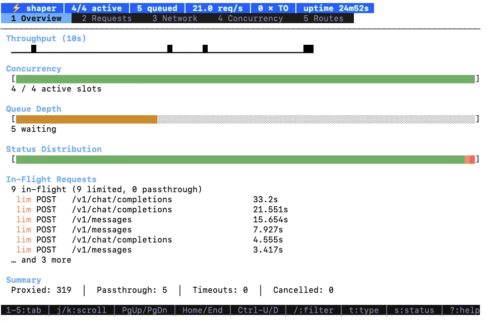

# ai-concurrency-shaper

Reverse proxy with bounded concurrency for AI/LLM API endpoints.

Sits in front of an upstream HTTP API (e.g. Anthropic, OpenAI) and limits concurrent requests to configured routes. Requests that exceed the limit block until a slot opens, so clients need no backoff of their own. Non-matching requests pass through unmodified.

The goal is that the upstream never *observes* more concurrency than you configured. Providers detect excess concurrency on their side, with their own accounting lag, and answer with 429s or temporary bans. So the proxy does more than count in-flight requests: it holds slots across the provider's accounting window after releases, cancellations, and failures, and a circuit breaker stops a failing upstream from being hammered.

Optionally, it also transcodes between the OpenAI Responses, OpenAI Chat Completions, and Anthropic Messages APIs (see [Transcoding](#transcoding)). Run with `-tui` for a terminal dashboard with live metrics and request inspection.

<p align="center">
  
</p>

## Install

```sh
go install github.com/joeycumines/ai-concurrency-shaper@latest
```

## Usage

```sh
ai-concurrency-shaper -upstream https://api.anthropic.com
```

Every tuning flag below applies to that single upstream. To front several upstreams through one port, see [Multiple Providers](#multiple-providers); the same flags then apply per `--provider` section.

### Flags

Every flag lives in one of two scopes. **Server-scope** flags configure the process (listener, TUI, model table, catalog suites, embedded RC server); **provider-scope** flags configure one upstream (limiting, retry, breaker, cooldowns, auth, transcoding). With a single upstream both scopes share one command line. With `--provider` sections, server-scope flags go before the first marker and each provider-scope flag goes in the section it configures.

Run `ai-concurrency-shaper -h` (also inside a provider section, e.g. `--provider=acme -h`) for the complete flag reference. Usage errors — unknown flags, malformed sections — exit 2 with a hint pointing at `-h`; semantic failures (bad values, missing upstream) exit 1.

| Flag | Scope | Default | Description |
|------|-------|---------|-------------|
| `-upstream` | provider | _(required)_ | Upstream base URL |
| `-bind` | server | `:8080` | Listen address |
| `-metrics-bind` | server | _(unset)_ | Dedicated listen address for the Prometheus `/metrics` endpoint (see [Metrics Export](#metrics-export)); empty disables it |
| `-model-table` | server | _(repeatable)_ | Global model identity entry `surrogate@provider=wire[;facts]` (see [Model identities](#model-identities-and-the-global-model-table)). Server scope, so with `--provider` sections every entry goes before the first marker |
| `-catalog-suite` | server | _(repeatable)_ | Mount a virtual catalog suite: `[name@]prefix[=models][;options]` (see [Catalog suites](#catalog-suites-unified-endpoints-and-model-routing)). Server scope |
| `-limit` | provider | _(repeatable)_ | Route pattern to limit, matched by trailing segments (defaults to common AI endpoints). A `:unlimited` suffix (`POST /messages/count_tokens:unlimited`) exempts the route from limiting entirely, including under `-limit-all` |
| `-limit-all` | provider | `false` | Limit all requests, not just matching routes. Use for "dumb" blanket rate limiting when you don't know the upstream's expensive routes. |
| `-concurrency` | provider | `4` | Max concurrent limited requests |
| `-global-concurrency` | provider | `0` | Global concurrency limit (0 = disabled) |
| `-queue-timeout` | provider | `30s` | Max wait for a concurrency slot |
| `-queue-depth` | provider | `0` | Max requests waiting for a slot at once (0 = unbounded, the documented blocking semantics). When the bound is reached, arriving requests fail fast with `429 Too Many Requests` + `Retry-After` — the protocol signal AI clients and the official SDKs already act on — instead of queueing silently and amplifying into client-side retries |
| `-queue-comments` | provider | `0` | SSE keep-alive comment interval while a streaming request is queued (0 = disabled). Commits `200` + SSE headers after breaker admission and before the slot wait; see [Queue comments](#queue-comments--queue-comments) for the trade-off |
| `-upstream-disable-keep-alives` | provider | `false` | Disable HTTP keep-alives to upstream; each request uses a fresh TCP connection. Use when the upstream counts idle connections as concurrent. |
| `-upstream-ca` | provider | _(unset)_ | CA for verifying the upstream certificate on the proxy's own TLS handshake (`file:PATH` or `base64:DATA`). Unset verifies against the system roots. Rejected with `-rc-terminate-tls` (use `-rc-target-ca` there) and on plaintext `http://` upstreams (nothing to verify against). |
| `-upstream-insecure` | provider | `false` | Skip upstream TLS certificate verification on the proxy's own handshake. Rejected with `-rc-terminate-tls` and on plaintext `http://` upstreams. A configured `-upstream-ca` is inert alongside it (nothing left to verify against). |
| `-upstream-server-name` | provider | _(unset)_ | TLS SNI override for the proxy's own upstream handshake. Rejected with `-rc-terminate-tls` and on plaintext `http://` upstreams. |
| `-retry` | provider | `-1` | Max retry attempts (-1 = unlimited, 0 = disabled) |
| `-retry-max-body-mb` | provider | `5` | Max request body size (MB) eligible for retry |
| `-auth-source` | provider | _(unset)_ | Upstream credential source: `env:VAR`, `file:PATH`, `exec:<JSON argv>` (a short-lived credential from a command, refreshed while running), or `none` (strip-only). Unset disables upstream auth entirely — requests are forwarded verbatim |
| `-auth-source-ttl` | provider | _(unset; required with `exec:`)_ | How long an `exec:` credential is used before the command runs again, measured from the start of the run that produced it (e.g. `50m` for a 1h key). Rejected with any other source |
| `-auth-source-timeout` | provider | `60s` | Max run time of the `exec:` command; it is killed (with its process group) after this. Must be > 0; rejected with any other source |
| `-auth-mode` | provider | `auto` | How the credential is attached: `auto` (derived from the upstream host), `bearer`, `x-api-key`, `api-key`, or `header:NAME`. `none` strips client credentials without injecting anything |
| `-auth-header` | provider | _(required by `header:` mode)_ | Custom upstream auth header name (e.g. `X-Goog-Api-Key`) |
| `-anthropic-version` | provider | `2023-06-01` | `Anthropic-Version` header value applied when the resolved mode is `x-api-key` |
| `-tui` | server | `false` | Enable terminal dashboard |
| `-version` | server | | Print version and exit |

The tables in [Concurrency Protection](#concurrency-protection), [Circuit Breaker](#circuit-breaker), and [Retry Tuning](#retry-tuning) are all provider-scope.

#### Concurrency Protection

The limiters bound the proxy's own concurrency. What the upstream observes depends on its accounting: providers measure concurrency differently (active connections, in-flight requests, token windows), and most lag between finishing a response and decrementing their counter. These flags hold a slot after its exchange ends so the upstream does not observe N+1, at the cost of throughput. The right values depend on the upstream; the defaults are conservative. [How Concurrency Protection Works](#how-concurrency-protection-works) explains how they combine.

| Flag | Scope | Default | Description |
|------|-------|---------|-------------|
| `-release-cooldown` | provider | `200ms` | Hold every slot this long after its exchange ends. Caps throughput at `limit / cooldown` req/s (5 req/s at limit 1). |
| `-cancel-cooldown` | provider | `200ms` | Hold the slot after a client disconnects once an upstream attempt has started, so rapid connect/disconnect cycles cannot produce N+1. |
| `-failure-hold` | provider | `2s` | Hold the slot after an upstream failure (5xx, 429, transport error, or rate-limit-signaled 403) when the circuit breaker is disabled. With the breaker enabled, its phantom penalty (`-cb-penalty`) is the hold instead. |
| `-retry-min-delay` | provider | `1s` | Minimum delay before a retry, so it does not arrive before the upstream has finished accounting for the failed attempt. |
| `-retry-skip-429` | provider | `true` | Do not retry 429 responses: retrying them adds concurrency at the upstream that is already refusing it. |
| `-adaptive-headroom` | provider | `false` | Reduce effective concurrency by one slot after a 429, restoring after a quiet window. Use when the provider can see N+1 concurrent requests due to connection teardown or CDN accounting lag. |
| `-adaptive-headroom-window` | provider | `30s` | How long the one-slot 429 headroom is held. Each new 429 resets this window. |

**Boundedness of transcode routes.** Concurrency limiting matches on the
route patterns configured with `-limit` (or every request with
`-limit-all`). A custom transcode route (`-transcode-route` or the
`-transcode-*` presets) whose client path matches **no** `-limit` pattern
flows through the passthrough limiter — bounded by `-global-concurrency`
when set, otherwise unbounded. If a transcoded route must be bounded but
its path is not a limited route, either set `-global-concurrency` or add an
explicit `-limit` pattern for that path.

The upstream HTTP transport sizes `MaxIdleConnsPerHost` to the sum of configured route/global concurrency caps, with a per-host minimum floor of 20 applied after the global cap. This avoids closing a large burst of healthy keep-alive connections when multiple route limiters or groups share the same upstream host. Use `-upstream-disable-keep-alives` only when the upstream counts idle/open connections as concurrent.

#### Circuit Breaker

| Flag | Scope | Default | Description |
|------|-------|---------|-------------|
| `-circuit-breaker` | provider | `true` | Enable circuit breaker |
| `-cb-threshold` | provider | `5` | Failures within window to trip the breaker |
| `-cb-window` | provider | `30s` | Failure counting window |
| `-cb-open-timeout` | provider | `10s` | Time before the breaker probes (half-open) |
| `-cb-max-open-timeout` | provider | `120s` | Max open timeout after backoff |
| `-cb-penalty` | provider | `2s` | Base phantom concurrency hold time |
| `-cb-max-penalty` | provider | `60s` | Max phantom concurrency hold time |

The circuit breaker treats 5xx, 429, transport errors, and rate-limit-signaled 403s as upstream failures. A bare 403 without `Retry-After` or `x-ratelimit-*` headers is treated as an authentication/authorization client error and is passed through, avoiding the trap where a bad API key is masked by a proxy-generated 503 after the breaker opens.

#### Metrics Export

Pass `-metrics-bind 127.0.0.1:2112` to expose a Prometheus text-format `/metrics` endpoint on a dedicated listener — it never shares the proxy port, so a bare-root provider keeps every path and scraping is never mistaken for proxied traffic. Every series carries a `provider` label (an unnamed single provider exports as `provider="default"`): `shaper_active`, `shaper_queued`, `shaper_oldest_queued_seconds` (age of the oldest limited request waiting on either limiter — per-route or global — `0.000` when no limited request is waiting; passthrough requests blocked in the global limiter count toward `shaper_queued` but carry no queue age), `shaper_retries_in_flight`, `shaper_clean_proxied_total`, `shaper_clean_passthrough_total`, `shaper_aborted_total`, `shaper_circuit_rejected_total`, `shaper_queue_rejected_total` (requests rejected by a `-queue-depth` bound with `429`), `shaper_requests_total{status="1xx"…"5xx"}`, and `shaper_breaker_state` (0 closed / 1 half-open / 2 open; omitted when the provider's breaker is disabled). While requests are waiting in a provider's per-route queues, two further families appear with `method` and `path` labels: `shaper_route_queued` (waiters per route) and `shaper_route_oldest_queued_seconds` (oldest waiter age per route); routes with no waiters export no series, and a route whose `method` or `path` label value is not valid UTF-8 exports no series either — the text parser rejects the whole document on an invalid label value, so the series is skipped (fail-closed), never sanitized, because sanitizing could collide two distinct routes into duplicate series. Series are grouped by metric name — each family forms one contiguous block across all providers — as the exposition format's grouping rule requires. The endpoint is off by default and binds after the proxy listener — a bad `-metrics-bind` address fails at startup after the proxy listener is released, and a proxy bind failure never leaves a metrics listener behind. Bind it to loopback unless you know what you are exposing.

#### Observability Semantics

The TUI summary separates clean completions from incomplete exchanges. `Clean proxied` and `Clean passthrough` count requests whose HTTP exchange completed through the proxy. `Aborted` counts exchanges that did not complete cleanly, including client disconnects, downstream write/flush failures, and upstream response-body copy failures; the request and network views mark those rows as aborted and leave response-complete timing unset. Status buckets still count any committed HTTP status, so an aborted stream that already received `200` appears in both the `2xx` bucket and `Aborted`.

For `101 Switching Protocols`, local inability to complete the requested upgrade (for example a non-Hijacker downstream writer or a `101` response body that is not bidirectional) and failed downstream 101 handshake write/flush are aborted HTTP exchanges, but they do not count as upstream breaker failures. Once the handshake succeeds, later WebSocket or other upgraded-protocol stream closes are treated as upgraded connection lifetime events, not HTTP response-body aborts.

#### Retry Tuning

| Flag | Scope | Default | Description |
|------|-------|---------|-------------|
| `-retry-wait-min` | provider | `500ms` | Minimum retry wait |
| `-retry-wait-max` | provider | `30s` | Maximum retry wait |

### Multiple Providers

Front several upstreams through one port with `--provider` sections. A `--provider[=name]` marker starts a new section; every provider-scope flag after it, until the next marker, configures that upstream only. Server-scope flags belong before the first marker.

```sh
ai-concurrency-shaper \
  -bind 127.0.0.1:8080 \
  -tui \
  --provider=anthropic \
    -upstream https://api.anthropic.com \
    -prefix /anthropic \
    -concurrency 4 \
  --provider=openai \
    -upstream https://api.openai.com \
    -prefix /openai \
    -concurrency 8 \
    -retry 2
```

A client targeting `http://127.0.0.1:8080/anthropic/v1/messages` reaches Anthropic's `/v1/messages`; `-concurrency 4` bounds only the Anthropic section, while OpenAI gets its own limiter (8) and retry budget (2). Without `-name` on the marker, the display name derives from the upstream host (`api.anthropic.com` → `anthropic`); an explicit `-name` inside the section overrides the marker.

Two provider-only flags join the surface in sectioned mode:

| Flag | Default | Description |
|------|---------|-------------|
| `-prefix` | _(required in multi mode)_ | Mount path for the provider, stripped before forwarding |
| `-name` | _(derived from upstream host)_ | Display name in logs and the TUI header |

Mount semantics:

- The prefix is a true mount: `/anthropic/v1/messages` is forwarded upstream as `/v1/messages`. A request equal to the mount (`/anthropic`) forwards as `/`.
- With more than one provider, requests matching no prefix get `404 Not Found` — nothing leaks to a default upstream. A single bare provider (no `--provider` markers, no prefix) serves every path from the root.
- Prefixes must not overlap: `/anthropic` and `/anthropic/v1` cannot coexist. Overlapping configurations are rejected at startup, before the listener binds.
- Providers are matched on whole path segments, so `/anthropic2` never matches the `/anthropic` prefix.

In the TUI, each provider keeps its own dashboard. When the terminal's width and height budget permits, the header shows one chip per provider (the active one highlighted), filled by the provider name instead of the `⚡ shaper` brand; `Tab`/`Shift+Tab` cycle providers, visible chips are clickable, and the number keys `1-6` still switch content tabs. A narrow or height-capped terminal may elide the chip row while retaining keyboard provider switching; the in-TUI help (`?`) advertises mouse controls only when those controls are visible. The header never leaves a truncated first chip alone on its row: when the first chip would not fit at its natural width beside the fleet identity, the row stays body-only and every chip starts on the next row; narrow terminals therefore show the body on row 0 with chips wrapped below, and wider terminals share leading chips beside the body, with clicks tracking the rendered spans.

#### Upstream Authentication

Each provider can carry its own upstream credential, so clients no longer need to know provider secrets at all. Credentials live in the **environment**, resolved once at startup; they never appear in command lines, logs, or the TUI.

```sh
export SHAPER_PROVIDER_ANTHROPIC_API_KEY=sk-ant-...   # resolved by the proxy at startup
export SHAPER_PROVIDER_OPENAI_API_KEY=sk-...

ai-concurrency-shaper \
  -bind 127.0.0.1:8080 \
  --provider=anthropic \
    -upstream https://api.anthropic.com \
    -prefix /anthropic \
    -auth-source env:SHAPER_PROVIDER_ANTHROPIC_API_KEY \
  --provider=openai \
    -upstream https://api.openai.com \
    -prefix /openai \
    -auth-source env:SHAPER_PROVIDER_OPENAI_API_KEY
```

With auth enabled, every proxied request has all client HTTP credential headers (`Authorization`, `Proxy-Authorization`, `X-Api-Key`, `Api-Key`, `X-Goog-Api-Key`) plus protocol headers (`Anthropic-Version`, `Anthropic-Beta`) and cloud signature families (`x-amz-*`, `x-goog-*`) stripped first — then exactly one upstream credential is attached. A client that sends OpenAI's token to the Anthropic mount cannot leak it to Anthropic, and vice versa: leakage of these credential headers is structurally impossible, not merely discouraged. The injection happens inside Go's `Rewrite` hook, where hop-by-hop headers have already been removed, so a malicious `Connection` header list cannot strip the injected credential.

One deliberate exception: **`Cookie` headers are forwarded verbatim** to whichever mount receives the request, even with auth enabled, because stripping them would break cookie-authenticated upstreams. The journal and TUI display raw headers and URLs, `Cookie` included: TUI output is not captured anywhere and is visible only to the local operator. If your clients send cookies you do not want forwarded, strip them before they reach the gateway.

The gateway never sends `X-Forwarded-For`, `X-Forwarded-Host`, `X-Forwarded-Proto`, or `Forwarded` upstream — client-supplied forwarding headers are removed and no client IP is injected (the gateway is a stealth hop). This is also true when auth is disabled.

Modes:

| `-auth-mode` | Upstream sees | Typical provider |
|--------------|---------------|------------------|
| `auto` _(default)_ | `x-api-key` for `api.anthropic.com`/`*.anthropic.com`, otherwise `Authorization: Bearer` | any |
| `bearer` | `Authorization: Bearer <secret>` | OpenAI-compatible |
| `x-api-key` | `X-Api-Key: <secret>` + configured `-anthropic-version` | Anthropic Messages |
| `api-key` | `Api-Key: <secret>` | Azure key-based |
| `header:NAME` | `NAME: <secret>` | Gemini-style custom headers (set `NAME` via `-auth-header NAME` instead if you prefer) |

Sources:

| `-auth-source` | Behavior |
|----------------|----------|
| `env:VAR` | Read `VAR` from the environment once at startup. Unset or blank → startup fails naming the variable |
| `file:PATH` | Read the secret from `PATH` once at startup. Unreadable or blank → startup fails naming the path |
| `exec:<JSON argv>` | Run a command for a short-lived credential, e.g. `exec:["/usr/local/bin/osm","ai-credential","--","bedrock-openai-shaper"]`, and keep it fresh for the life of the process (see below). Requires `-auth-source-ttl`. The command runs once at startup; failure fails startup |
| `none` | Strip-only hygiene: client credentials are removed, nothing is injected |
| _(unset)_ | Auth disabled entirely: requests are forwarded verbatim |

Where secrets can and cannot appear: a referenced variable's *value* is never logged, printed, or written anywhere by the proxy; startup logs name only the *reference* (`env:SHAPER_PROVIDER_ACME_API_KEY`). The journal and TUI may show raw credential headers and URLs (including upstream `Set-Cookie` and `?key=` query strings), since that output is visible only to the local operator. Log lines are different, because logs are captured: transport-error logs have every credential query parameter of every URL carried by a `*url.Error` reachable through the error chain's `Unwrap` links redacted (raw and quoted spellings; a URL a wrapper exposes only through a custom `As` method is not enumerable and stays out of scope). Passing secrets as literal argv values would expose them in `ps`/`/proc`; use env references instead.

Other credential channels outside the header allowlist are your responsibility: credentials embedded in path segments are forwarded by design and appear in route labels and request listings; request bodies captured for the TUI preview may contain whatever the client sent; custom secret headers not in the strip list above are forwarded verbatim and shown unredacted. If clients send secrets through these channels that you do not want stored or displayed locally, strip them before they reach the gateway.

`env:` and `file:` credentials are pinned at startup: rotating them requires a restart. `exec:` is the rotation exception, built for short-lived bearer credentials such as Amazon Bedrock short-term API keys:

- **Execution.** The argv is a JSON array of non-empty strings run directly, without a shell; `argv[0]` is an absolute path or a bare name resolved through `PATH`. Stdin is the null device, the proxy's environment is inherited, stderr is discarded, and the credential is the first line of stdout, trimmed (at most 64 KiB of output is read). A run that exits non-zero, exceeds `-auth-source-timeout`, or prints no credential is an error reported by class only (`exec secret source: command exited with status 1`, `... timed out after 1m0s`, `... produced no output`) — command output never appears in errors or logs.
- **Caching and refresh.** A credential is used for `-auth-source-ttl` from the start of the run that produced it. Once it is within `min(ttl/5, 5m)` of expiry, the next request starts a background refresh and is served the still-valid value, so steady traffic never waits on the command; a request arriving after expiry waits for the refresh. Refreshes are request-driven, so an idle proxy never runs the command. Concurrent requests share a single in-flight run.
- **Resilience.** If a refresh fails while a previous credential exists, the previous one keeps being served (an expired one surfaces as the upstream's own 401) and the refresh is retried with exponential backoff from 1s to 1m. Requests fail only when no credential has ever been obtained.
- **Rejection recovery.** When the upstream answers a request authenticated by an `exec:` credential with `401`, or with a `403` that carries no rate-limit signal (`Retry-After` / `x-ratelimit-*` 403s are temporary bans, not credential failures), the credential is invalidated and the request is re-sent exactly once with a fresh one — on passthrough, native, and transcoded routes alike. The re-send needs a replayable body: transcoded requests always are, passthrough requests are when retries are enabled and the body fits `-retry-max-body-mb`. Otherwise the rejection is returned as-is and the next request uses the fresh credential. Forced refreshes are rate-limited to one per 5s, and a rejection of a credential that has already been replaced does not trigger another, so a burst of 401s cannot run the command repeatedly. Every request waits for the first forced refresh, so none is sent with the refused credential. If the replacement is refused too, the upstream is refusing for a reason other than the credential (for example a 403 for a model the account is not entitled to). From then on, forced refreshes run in the background with only the refused request waiting, and the spacing doubles per repeat (up to 5m) until the next scheduled refresh. `env:`/`file:` credentials are never re-sent on 401/403.
- **Custody.** The proxy keeps the credential in memory and never logs it; the startup log names the `exec:` argv (the reference), never the value. As with every source, the opt-in `-transcode-flowlog-dir` recorder writes upstream request headers unredacted, so the credential is written there when it is enabled.

A multi-provider configuration with no auth on some providers prints one startup note (`N of M providers configured without upstream auth`) so an open relay is never silent.

#### Scope & Limitations

Standard provider mounts route by **path prefix** (`/anthropic/...`, `/openai/...`). For a single unified endpoint with body-aware model routing across providers, use [Catalog suites](#catalog-suites-unified-endpoints-and-model-routing).

Other deliberate boundaries:
- **No downstream client authentication.** Anything that can reach the port can use every mounted provider. Transcoding's `inbound` credential mode forwards the client's credential; it is not virtual-key admission.
- **No identity rotation.** The proxy does not rotate local addresses, User-Agents, or API keys on 429. Providers enforce limits per organization, project, or billing account, so N keys in one organization do not buy N times the quota. Model separate accounts or regions as separate `--provider` sections, each with its own limiters and breaker.
- **Static configuration.** Readiness is TCP-connect only, and configuration changes require a restart.

### RemoteControl.NetConn Dialing

A provider's upstream connections can be dialed through a [sesame RemoteControl.NetConn](https://github.com/joeycumines/sesame) target: a gRPC service that dials connections on the client's behalf and streams them back, optionally terminating upstream TLS and traversing egress proxies ahead of the dial. The shaper supports both roles: **client flags** (`-rc-*`, provider scope) configure how a provider dials through an RC server, and **server flags** (`-rc-server-*`, server scope) let the binary itself act as an RC target.

#### Provider flags (`-rc-*`, per-provider)

| Flag | Description |
|------|-------------|
| `-rc-server` | RC server address (`host:port`). Empty = direct dialing; all other `-rc-*` flags require this. |
| `-rc-dial-timeout` | Timeout for the remote dial through the RC server (0 = no timeout). |
| `-rc-channel-tls` | Enable TLS on the gRPC channel to the RC server. |
| `-rc-channel-ca` | CA for verifying the RC server certificate (`file:PATH` or `base64:DATA`; requires `-rc-channel-tls`). |
| `-rc-channel-cert` | Client certificate for mTLS on the gRPC channel (`file:PATH` or `base64:DATA`; requires `-rc-channel-tls` and `-rc-channel-key`). |
| `-rc-channel-key` | Client private key for mTLS on the gRPC channel (`file:PATH` or `base64:DATA`; requires `-rc-channel-tls` and `-rc-channel-cert`). |
| `-rc-channel-server-name` | TLS SNI override for the gRPC channel (requires `-rc-channel-tls`). |
| `-rc-channel-insecure` | Skip TLS verification on the gRPC channel (requires `-rc-channel-tls`). |
| `-rc-terminate-tls` | Terminate upstream TLS **at the RC server** instead of inside the proxy. Enables the `-rc-target-*` flags below; without it the tunnel is plain TCP and the proxy performs TLS normally. Rejected on a plaintext `http://` upstream, which has no handshake to terminate. |
| `-rc-target-server-name` | Upstream TLS SNI for the handshake terminated at the RC server (requires `-rc-terminate-tls`). |
| `-rc-target-ca` | CA for verifying the upstream certificate (`file:PATH` or `base64:DATA`; requires `-rc-terminate-tls`). |
| `-rc-target-cert` | Client certificate for upstream mTLS (`file:PATH` or `base64:DATA`; requires `-rc-terminate-tls` and `-rc-target-key`). |
| `-rc-target-key` | Client private key for upstream mTLS (`file:PATH` or `base64:DATA`; requires `-rc-terminate-tls` and `-rc-target-cert`). |
| `-rc-target-min-version` | Minimum upstream TLS version: `1.0`, `1.1`, `1.2`, or `1.3` (requires `-rc-terminate-tls`; a floor above `-rc-target-max-version` is rejected). |
| `-rc-target-max-version` | Maximum upstream TLS version (same values; requires `-rc-terminate-tls`). |
| `-rc-target-client-hello` | Decomposed wire-level ClientHelloSpec for the upstream handshake as protojson (`file:PATH`, `base64:DATA`, or inline JSON; requires `-rc-terminate-tls`; empty = engine default; the server fails closed on any dimension it cannot honour exactly). See [Upstream TLS fingerprinting](#upstream-tls-fingerprinting-clienthellospec). |
| `-rc-target-alpn` | ALPN protocol offered during the upstream handshake (repeatable; requires `-rc-terminate-tls`). Only `http/1.1` is accepted: a remote-terminated connection carries HTTP/1.1 only (see the validation note below). |
| `-rc-target-insecure` | Skip upstream TLS certificate verification (requires `-rc-terminate-tls`). |
| `-rc-flow-control` | Advertise flow-control support on the RC stream (switches to the in-stream control path). |
| `-rc-window-size` | Flow-control window size in bytes (0 = server default; requires `-rc-flow-control`). Values above int32 max are rejected at startup. |
| `-rc-opportunistic-tls` | Advertise opportunistic TLS upgrade support on the RC stream. |
| `-rc-proxy-hop` | Egress proxy hop ahead of the upstream dial: `http-connect|socks5@host:port[;user=U][;pass=P][;header=H]` (repeatable). |

Certificate and key material uses explicit prefixes: `file:/path/to/pem` reads from disk, `base64:DATA` decodes inline PEM. Unprefixed values are rejected without echoing the content back into the error, and the same no-echo rule covers `-rc-proxy-hop` parse errors (option position and size only) and `-sesame-endpoint` validation (a URL-form userinfo is never printed).

Validation is fail-closed, and every check runs during configuration resolution — before any socket is bound or dialled. `-rc-channel-cert` requires `-rc-channel-key` (and vice versa), `-rc-target-*` options require `-rc-terminate-tls`, `-rc-window-size` requires `-rc-flow-control`, and any `-rc-*` flag without `-rc-server` is a startup error. All configured PEM (`-rc-channel-*`, `-rc-target-*`, `-rc-server-*`) is parsed at startup, and a configured value that decodes to zero bytes is an error rather than "unset": an empty CA or certificate would otherwise silently fall back to the system roots or omit the certificate while the flags said otherwise.

The upstream ALPN offer is constrained to HTTP/1.1. Under `-rc-terminate-tls` the proxy dials through `http.Transport.DialTLSContext`, whose returned connection is not a `*tls.Conn`, so net/http never learns the negotiated protocol and never sends an HTTP/2 preface. Any other offer, in `-rc-target-alpn` or in a `-rc-target-client-hello` ALPN extension (which must also be a well-formed protocol list), would let the upstream select a protocol the exchange cannot use, so it is refused at startup. An empty offer is safe: the sesame server then sends no ALPN extension at all.

The `-upstream-ca`, `-upstream-insecure`, and `-upstream-server-name` flags configure the handshake the proxy performs itself (direct dialing, or the RC tunnel without `-rc-terminate-tls`). Under `-rc-terminate-tls` the proxy never handshakes, so they are rejected at startup rather than silently ignored; the `-rc-target-*` options replace them.

The gRPC channel is lazy (`grpc.NewClient`): an unreachable RC server does not fail startup, and dial errors surface at request time as transport failures. A refused RC server fails fast; a blackholed one holds the first request's dial until the client gives up, unless `-rc-dial-timeout` bounds it. The default is 0 (no timeout), matching the proxy's blocking-slot semantics, so set it when the RC server is across an unreliable network. There is no per-attempt HTTP timeout on any path (direct or RC): once admitted, a stalled upstream holds its limiter slot until the client cancels. The blast radius is per provider: one stalled mount starves its own limiters, not the others'.

#### Server flags (`-rc-server-*`, server scope)

| Flag | Description |
|------|-------------|
| `-rc-server-bind` | Listen address for the embedded RC gRPC server (empty = disabled). |
| `-rc-server-tls` | Enable TLS on the embedded RC server listener. |
| `-rc-server-ca` | CA for client certificate verification, enforcing mTLS (`file:PATH` or `base64:DATA`). |
| `-rc-server-cert` | Server certificate (`file:PATH` or `base64:DATA`; requires `-rc-server-tls` and `-rc-server-key`). |
| `-rc-server-key` | Server private key (`file:PATH` or `base64:DATA`; requires `-rc-server-tls` and `-rc-server-cert`). |

The embedded server registers sesame's `netconn.Server` with default settings: upstream dials go through `DefaultDialer`, a plain `net.Dialer` honoring the request's dial timeout. A `-rc-target-client-hello` spec is authoritative for its handshakes: the server honours every dimension it can honour exactly and fails closed on the rest (see the engine ceilings below), and there is no session-ticket flag because sesame's `BuildTLSConfig` does not use the field.

#### Upstream TLS fingerprinting (ClientHelloSpec)

`-rc-target-client-hello` carries a decomposed, wire-level `ClientHelloSpec`
(protojson) for the upstream handshake terminated at the RC server. The value
is read from disk with `file:PATH`, decoded with `base64:DATA`, or passed
inline as JSON starting with `{`; decoding is strict — unknown fields are
rejected, out-of-range values fail at startup — and an empty value leaves the
engine default. The spec is authoritative: the server honours every requested
dimension exactly or fails closed before the handshake, and the client
additionally verifies the server's applied-spec echo, aborting on mismatch.

**Engine ceilings (honest limits).** The shaper's embedded RC server is
sesame's Go `netconn.Server`, backed by Go `crypto/tls`, which exposes no
knob for several ClientHello dimensions. The engine therefore honours only
exact-match specs and rejects anything it cannot emit byte-for-byte:

- `cipherSuites` — honoured only when the effective max version is TLS 1.2
  (`-rc-target-max-version 1.2`); Go appends its TLS 1.3 suites in a fixed
  order whenever TLS 1.3 remains reachable. The requested list must also
  equal Go's fixed preference order filtered by membership — user-specified
  order is never emitted.
- `supportedGroups` — exact-match over Go's fixed curve preference order
  (same membership-filter rule), including its removal of TLS-1.3-only key
  exchanges below TLS 1.3.
- `sessionIdLength` — Go always sends 32 bytes; only `0` (engine default)
  and `32` are compatible.
- `signatureAlgorithms`, `extensions`, `legacyVersion`, `targetSize` — no Go
  engine control; any non-default value fails closed. `compressionMethods`
  accepts only `[0]` (null), Go's sole emission.

The sesame-endpoint builtin (node:tls) likewise rejects all non-default
specs. Full-fidelity opencode/Bun TLS impersonation — the Bun-derived
ClientHello layout — is therefore not a shaper feature: it is provided by
plugging a custom `TLSProvider` into sesame-endpoint's
`createRemoteControlService`, a sesame-repo integration.

Worked example (boot-tested: the subprocess e2e suite drives this exact spec
through the built binary — `TestRC_ClientHelloSpec_E2E` — and proves both the
honoured handshake and the fail-closed rejection of an unhonourable spec):

```sh
ai-concurrency-shaper \
  -bind 127.0.0.1:8082 \
  --provider=openai \
    -upstream https://api.openai.com \
    -rc-server 127.0.0.1:9443 \
    -rc-terminate-tls \
    -rc-target-max-version 1.2 \
    -rc-target-client-hello '{"cipherSuites":[49195,49199],"sessionIdLength":32}'
```

The spec pins two AES-GCM ECDHE suites — a membership-filter-stable subset of
Go's preference table — and the 32-byte session id: the combination the Go
engine can honour exactly at TLS 1.2.

#### Worked example: proxy → RC target → upstream with mTLS

The embedded RC server runs inside a proxy process alongside at least one provider. To separate the roles across machines, run a standalone sesame RC server on the remote host; the shaper's embedded mode is intended for testing and single-binary deployments.

```sh
# Proxy with embedded RC server (mTLS) and a passthrough provider
ai-concurrency-shaper \
  -bind 127.0.0.1:8080 \
  -rc-server-bind 127.0.0.1:9443 \
  -rc-server-tls \
  -rc-server-ca    file:ca.pem \
  -rc-server-cert  file:server.pem \
  -rc-server-key   file:server-key.pem \
  --provider=local \
    -upstream http://127.0.0.1:8081

# Second proxy dialing through the first proxy's RC server
ai-concurrency-shaper \
  -bind 127.0.0.1:8082 \
  --provider=openai \
    -upstream https://api.openai.com \
    -rc-server 127.0.0.1:9443 \
    -rc-channel-tls \
    -rc-channel-ca    file:ca.pem \
    -rc-channel-cert  file:client.pem \
    -rc-channel-key   file:client-key.pem \
    -rc-terminate-tls \
    -rc-target-server-name api.openai.com
```

The second proxy's upstream requests traverse the RC stream: the first proxy's embedded RC server dials `api.openai.com`, terminates TLS, and streams the connection back; the second proxy performs no upstream TLS handshake itself. The channel certificates all come from one CA: the server leaf needs `127.0.0.1` in its subject alternative names because the channel verifies the server certificate against the `-rc-server` address, and the client leaf must chain to the CA the server uses for client verification. The example sets no `-rc-target-ca`, so the upstream handshake verifies `api.openai.com` against the system roots; set `-rc-target-ca` only when the upstream presents a certificate from a private CA.

### Examples

Proxy with default limits and TUI:

```sh
ai-concurrency-shaper -upstream https://api.anthropic.com -tui
```

`-limit` patterns are **end-anchored suffix matches**: only the trailing path segments matter, and the path may have any prefix. This means `-limit "POST /chat/completions"` matches `/v1/chat/completions` and `/api/v2/chat/completions`, but it does **not** match `/v1/chat/completions/123`. A sub-resource needs its own `-limit` pattern or it passes through unlimited.

```sh
# matches /v1/chat/completions and /openai/deployments/x/chat/completions
ai-concurrency-shaper \
  -upstream https://api.openai.com \
  -limit "POST /chat/completions:2" \
  -limit "POST /embeddings:4" \
  -global-concurrency 10
```

Grouped routes sharing a limiter:

```sh
ai-concurrency-shaper \
  -upstream https://api.anthropic.com \
  -limit "POST /messages:3@messages" \
  -limit "POST /messages/batches:3@messages"
```

Two upstreams behind one port (see [Multiple Providers](#multiple-providers) for the mount and switcher details):

```sh
ai-concurrency-shaper \
  -bind 127.0.0.1:8080 \
  -tui \
  --provider=anthropic \
    -upstream https://api.anthropic.com \
    -prefix /anthropic \
  --provider=openai \
    -upstream https://api.openai.com \
    -prefix /openai \
    -limit "POST /chat/completions:8"
```

Maximum throughput (disable all protections; only safe if the upstream has no accounting lag):

```sh
ai-concurrency-shaper \
  -upstream https://api.anthropic.com \
  -circuit-breaker=false \
  -release-cooldown 0 \
  -cancel-cooldown 0 \
  -failure-hold 0 \
  -retry-min-delay 0 \
  -retry-skip-429=false
```

### Concrete Example

Proxying to an API with strict concurrency limits, slow accounting, streaming responses, and occasional 5xx errors:

```sh
ai-concurrency-shaper \
  -upstream https://api.example.com \
  -concurrency 4 \
  -queue-timeout 30m \
  -bind 127.0.0.1:8080 \
  -tui \
  -retry 2 \
  -retry-min-delay 5s \
  -retry-skip-429=true \
  -release-cooldown 500ms \
  -cancel-cooldown 500ms \
  -circuit-breaker=true \
  -cb-threshold 2 \
  -cb-window 10s \
  -cb-penalty 5s \
  -cb-max-penalty 60s \
  -upstream-disable-keep-alives \
  -adaptive-headroom \
  -adaptive-headroom-window 30s
```

- **`-concurrency 4`** matches the upstream's per-key limit. At most 4 requests are in flight.
- **`-queue-timeout 30m`** LLM streaming requests can take minutes. A 30s timeout would kill legitimate long-running requests.
- **`-retry 2`** bounded retries. More than 2 risks amplifying load during an outage; unlimited (`-1`) is only safe when the upstream recovers quickly.
- **`-retry-min-delay 5s`** the upstream has slow accounting. Without this floor, the default backoff (starting at 500ms) could send a retry before the upstream has accounted for the failed attempt.
- **`-retry-skip-429=true`** a 429 means the upstream is overloaded. Retrying adds concurrent requests and makes the problem worse.
- **`-release-cooldown 500ms`** the default 200ms is too aggressive for this upstream; accounting lag is closer to 500ms.
- **`-cancel-cooldown 500ms`** mitigates N+1 from rapid disconnect/reconnect cycles.
- **`-cb-threshold 2` / `-cb-window 10s`** trip after 2 failures in 10s. Aggressive, but appropriate when the upstream is generally reliable and any 5xx indicates a real problem. Bare 403 auth errors do not count unless the response carries rate-limit signals.
- **`-cb-penalty 5s` / `-cb-max-penalty 60s`** phantom penalty: after a failure the slot is held as if the request were still in flight, so fewer requests reach the struggling upstream. The penalty grows with consecutive failures (the first failure holds two base units, 10s here) and is followed by the release cooldown.
- **`-upstream-disable-keep-alives`** the provider counts *open* connections, not just in-flight requests. Without this, idle keep-alive connections can push the observed concurrency above the `-concurrency 4` limit and trigger 429s.
- **`-adaptive-headroom` / `-adaptive-headroom-window 30s`** some providers (or their CDNs) can still observe a momentary N+1 concurrent requests because connection teardown is asynchronous. When a 429 arrives, these flags temporarily reduce the effective limit by one slot, creating headroom. The slot is restored after 30s with no new 429s.

## Transcoding

The proxy can transcode requests between the OpenAI Responses API
(`/v1/responses`), the OpenAI Chat Completions API (`/v1/chat/completions`,
upstream only), and the Anthropic Messages API (`/v1/messages`). A
transcoded route is **method + path** scoped and intercepts only the
configured client route; every other route stays a transparent passthrough.
Transcoding is **off by default** — no mapping, no interception.

### Transcoding Flags

All transcoding flags are **provider-scope**: in sectioned mode (`--provider`), each flag configures that specific provider's transcode mappings.

| Flag | Scope | Default | Description |
|------|-------|---------|-------------|
| `-transcode-route` | provider | _(repeatable)_ | Explicit transcode route mapping (`client-proto@client-path=upstream-proto@upstream-path`) |
| `-transcode-responses-chat` | provider | `false` | Preset: Responses client (`POST /v1/responses`) → Chat upstream (`POST /v1/chat/completions`) |
| `-transcode-messages-chat` | provider | `false` | Preset: Messages client (`POST /v1/messages`) → Chat upstream (`POST /v1/chat/completions`) |
| `-transcode-messages-responses` | provider | `false` | Preset: Messages client (`POST /v1/messages`) → Responses upstream (`POST /v1/responses`) |
| `-transcode-chat-capability` | provider | _(repeatable)_ | Enable or withdraw (`!name`) an optional chat upstream capability |
| `-transcode-allow-client-query` | provider | _(repeatable)_ | Forward client query parameter (`name` or withdraw `!name`) |
| `-transcode-allow-loss` | provider | _(repeatable)_ | Approve non-portable semantic loss by granular key (or withdraw `!key`) |
| `-transcode-strict-defaults` | provider | `false` | Strip all out-of-the-box chat capabilities, query parameters, and loss approvals |
| `-transcode-model` | provider | _(repeatable)_ | Map client model name to upstream model name (`client=upstream`), identity fallback when omitted. Cannot be combined with `-model-table` — see [Migrating from -transcode-model](#migrating-from--transcode-model) |
| `-transcode-profile` | provider | _(repeatable)_ | Map profile name to upstream model and optional reasoning tier: `name=model[:tier]` (see [Agent profiles](#agent-profiles--transcode-profile)) |
| `-transcode-continuity` | provider | `false` | Opt-in per-conversation continuity store for `previous_response_id` against stateless chat upstreams (see [Conversation continuity store](#conversation-continuity-store--transcode-continuity)) |
| `-transcode-continuity-capacity` | provider | `1024` | Max retained conversation chains for the continuity store (0 = default 1024) |
| `-transcode-continuity-ttl` | provider | `30m` | Max age of a retained conversation chain (0 = default 30m) |
| `-transcode-auth` | provider | _(unset — inherits provider auth, else none)_ | Per-route target auth mode override (`auto`, `none`, `bearer`, `x-api-key`, `api-key`, `header`) |
| `-transcode-auth-source` | provider | _(unset — inherits provider auth, else none)_ | Per-route credential source override (`inbound`, `env:VAR`, `file:PATH`, `provider`) |
| `-transcode-auth-header` | provider | _(required for custom header mode)_ | Header name when `-transcode-auth` is custom `header` |
| `-transcode-anthropic-version` | provider | `2023-06-01` | Anthropic-Version header value when target auth mode resolves to `x-api-key` |
| `-transcode-max-request-mb` | provider | `10` | Max unmarshaled request body size (MB) for transcoding |
| `-transcode-max-response-mb` | provider | `10` | Max unmarshaled non-streaming response body size (MB) for transcoding |
| `-transcode-flowlog-dir` | provider | `` (disabled) | Existing directory that receives one unredacted JSON record per transcoded exchange, capturing the full flow (client request, converted upstream request, upstream response, downstream response); empty disables the recorder |
| `-native-route` | provider | _(repeatable)_ | Natively served route: `protocol@path` with protocol `responses`, `messages`, or `chat`. A request whose model's `via` dialect matches is forwarded with only the model identifier rewritten; a mismatch — or a model the native map cannot resolve at all, such as a `-transcode-profile` name — falls through to any transcode mapping on the same path (see [Native passthrough](#native-passthrough)) |
| `-opencode` | provider | `false` | Emit the opencode first-party request shape upstream: `User-Agent`, `x-opencode-client`, session affinity and identity headers (see [opencode Zen and Go](#opencode-zen-and-go)) |
| `-opencode-user-agent` | provider | `opencode/1.18.35` | `User-Agent` the `-opencode` preset asserts upstream |
| `-opencode-client` | provider | `cli` | `x-opencode-client` the `-opencode` preset asserts upstream |

A client route carrying **two** transcode mappings (for example `-transcode-messages-chat` together with `-transcode-messages-responses`) is dispatched by the request model's declared upstream dialect: each `-model-table` entry's `via=` fact decides whether that model is served by the chat or the responses upstream. A model with no `via=` fact falls back to the chat target, so the responses target is reachable only through a `via=responses` entry; without one, startup refuses the configuration, naming `-model-table`. A `-transcode-profile` follows its target model's dialect. A single mapping on a route is the operator's blanket serving choice and needs no dialect fact.

### Route examples

```sh
# Responses client -> Chat upstream (transcode /v1/responses to /v1/chat/completions)
ai-concurrency-shaper -upstream https://api.openai.com -transcode-responses-chat

# Messages client -> Responses upstream
ai-concurrency-shaper -upstream https://api.openai.com -transcode-messages-responses

# Messages client -> Chat upstream
ai-concurrency-shaper -upstream https://api.anthropic.com -transcode-messages-chat \
  -transcode-allow-loss usage_unknown

# Explicit route with a custom path
ai-concurrency-shaper -upstream https://api.example.com \
  -transcode-route "responses@/v1/responses=chat-completions@/v1/chat/completions"
```

Both Messages presets map `/v1/messages`; enabled together they form one
two-target route dispatched by model dialect (see above). Messages tools
carry no strictness setting while Responses function tools require one, so
every Messages-to-Responses mapping, preset or explicit route, approves the
`tool_schema_strictness` loss by default. Under `-transcode-strict-defaults`,
or with `-transcode-allow-loss '!tool_schema_strictness'`, the mapping is a
startup error unless the loss is approved explicitly.

### Model identities and the global model table

`-model-table` (server scope, repeatable) declares the gateway's client-visible
model identities once, globally:

```
surrogate@provider=wire[;facts]
```

- `surrogate` is the name clients send and the name responses echo back
  (letters, digits, `.`, `_`, `-`; 1–128 characters). It is the only model
  identifier a client ever sees.
- `provider` is the effective provider name — `-name` when set, the
  `--provider=` marker, or the host-derived name (`api.anthropic.com` →
  `anthropic`) — matched case-sensitively.
- `wire` is the upstream model id, opaque to the shaper (letters, digits, and
  `._-/:@=+`, so ids like `openai/gpt-4o` and `glm-5.3-flash:dev` pass through
  verbatim; 1–256 characters), forwarded upstream and never leaked into a
  client response.
- Optional `;`-separated facts — `context=<positive int>`,
  `max_output=<positive int>`,
  `efforts=minimal+low+medium+high+xhigh+max`,
  `modalities=text+image`, `default`, `deprecated`,
  `cost_input=<non-negative decimal>`, `cost_output=<non-negative decimal>`,
  `tags=tag+...`, `description=<text>`, `created=<non-negative int>` — are
  validated at startup and served by the [model catalog](#model-catalog-get-v1models).
  They are presentation-only: no fact affects conversion, resolution, or
  admission.

Surrogates form one global namespace: a duplicate surrogate, an entry naming
an unknown provider, a provider with transcode routes that no entry names, a
provider with entries but no transcode route, and two `default`s on one provider
are all startup errors. A table-backed alias is rejected on a passthrough-only
provider because that mount has no model-resolution path on which the advertised
surrogate could reach its wire id. Because the table is server scope, every
entry goes before the first `--provider` marker.

Each transcoded mount serves exactly the entries naming it, projected onto
that mount's model map at startup: a request naming an unlisted model is a
local 400 that names the mount's servable surrogates, never a silent identity
fallback. With no entries at all the behavior is unchanged — identity fallback
applies unless `-transcode-model` supplies explicit mappings.

Startup logs one summary line (sorted by surrogate; facts in parentheses):

```
model table: 2 surrogates across 2 providers: gpt4o@openai->gpt-4o(context=128000,default,max_output=16384), opus@anthropic->claude-opus-4-1(context=200000,default)
```

### Model catalog (GET /v1/models)

When at least one `-model-table` entry names a mount, `GET /v1/models` on that
mount is answered locally from the frozen table — the upstream is never
contacted and the request never queues behind in-flight completions. The
document lists exactly that mount's surrogates, and every listed identifier
resolves on the mount that served it.

The dialect is selected by the strongest available signal: `?format=`
(`codex`, `anthropic`, or `openai`; `responses` and `messages` are accepted as
aliases for the first two, `chat`/`chat-completions` for the last), then the
Codex `?client_version=` probe (native `{"models":[...]}` document), then an
`Anthropic-Version`/`Anthropic-Beta` header (messages-list document with
`after_id`/`before_id`/`limit` pagination), then the mount's default —
Responses mounts are Codex native, Messages mounts are Anthropic native, and
everything else gets the lean OpenAI list. The accepted query parameters are
`format`, `client_version`, and `beta` on every shape, plus the pagination trio
on the Anthropic shape. Every supplied key must have exactly one non-empty
value; malformed escapes, semicolon separators, repeated selectors/cursors, and
unknown keys are local 400s, never forwarded upstream.

Wire ids never appear in any served document. Optional facts are omitted (or
`null` where the client contract requires the key). Anthropic `capabilities` is
derived from what the table entry actually declares: effort support and its
per-tier leaves from `efforts`, `image_input` from `modalities`, and
`structured_outputs` from the mount's resolved chat capability, with everything
the table does not declare reported as an honest negative rather than a
fabricated yes. A model entry carrying no facts at all renders `capabilities:
null` rather than an all-negative document.
Codex-required fields are always present: `truncation_policy` uses the declared
context or a conservative 32K-token fallback, `input_modalities` uses the
declared list or `["text"]`, and `use_responses_lite` plus `support_verbosity`
are `false` rather than optimistic claims. One malformed entry is skipped
rather than failing the listing. A mount with no entries keeps
`GET /v1/models` a transparent passthrough.

### Catalog suites (unified endpoints and model routing)

`-catalog-suite` (server scope, repeatable) mounts a virtual catalog suite that combines local model discovery with body-aware completion routing:

```
[name@]prefix[=models][;options]
```

- `prefix`: mount path (e.g. `/suite` or `/v1`).
- `name`: optional display label (defaults to a sanitized prefix or `catalog`).
- `models`: optional `+`-delimited list of model surrogates from `-model-table` to expose (defaults to all models in the global table).
- Semicolon-delimited options (`key=value`):
  - `format=codex|anthropic|openai|auto`: default catalog response dialect for discovery queries.
  - `provider=name`: filter suite models to a single named provider.
  - `strict=true|false`: when `false` and only one provider is configured, requests for unmapped models fall back to that provider; when `true` (or multiple providers exist), unmapped models return a client-dialect 404/400 error.

Discovery (`GET <prefix>/v1/models`) is answered locally from the catalog, without upstream calls or queueing. The completion routes `POST <prefix>/v1/messages`, `/v1/responses`, and `/v1/chat/completions` read the request's `model` and dispatch only to a provider that serves that model on that route. `POST <prefix>/v1/messages/count_tokens` is routed the same way, so a token-count probe gets an Anthropic-dialect answer rather than a bare 404 page. Any other path answers a dialect-shaped 404 unless a non-strict suite forwards it to its single provider.

Example:
```sh
ai-concurrency-shaper \
  -model-table 'sonnet@anthropic=claude-3-5-sonnet-20241022' \
  -model-table 'gpt4o@openai=gpt-4o' \
  -catalog-suite '/suite=sonnet+gpt4o;format=auto' \
  --provider=anthropic \
    -upstream https://api.anthropic.com \
    -prefix /anthropic \
    -transcode-messages-chat \
  --provider=openai \
    -upstream https://api.openai.com \
    -prefix /openai \
    -transcode-responses-chat
```

### Migrating from -transcode-model

Per-provider `-transcode-model client=upstream` entries migrate mechanically:
move each entry to the global table with its provider's name added. Where the
same client string previously meant different things on different mounts, the
global namespace forces an explicit choice — rename one surrogate or collapse
the pair onto one target — and the startup duplicate check enforces it.

```sh
# Before: per-provider mappings, one owner per mount
ai-concurrency-shaper \
  --provider=anthropic \
    -upstream https://api.anthropic.com \
    -prefix /anthropic \
    -transcode-messages-chat \
    -transcode-model opus=claude-opus-4-1 \
  --provider=openai \
    -upstream https://api.openai.com \
    -prefix /openai \
    -transcode-responses-chat \
    -transcode-model gpt4o=gpt-4o

# After: one global table, each entry naming its provider
ai-concurrency-shaper \
  -model-table 'opus@anthropic=claude-opus-4-1' \
  -model-table 'gpt4o@openai=gpt-4o' \
  --provider=anthropic \
    -upstream https://api.anthropic.com \
    -prefix /anthropic \
    -transcode-messages-chat \
  --provider=openai \
    -upstream https://api.openai.com \
    -prefix /openai \
    -transcode-responses-chat
```

The client-visible behavior is unchanged: clients send the surrogate, the
upstream sees the wire id, and responses echo the surrogate. Rollback is
deleting the entries and restoring `-transcode-model`; a configuration
carrying both fails startup naming the provider, so the migration is never
half-applied silently.

### Agent profiles (-transcode-profile)

`-transcode-profile` (provider scope, repeatable) maps abstract agent profile names to concrete models and optional reasoning tiers:

```
name=model[:tier]
```

- `name`: profile identifier passed in the request `model` field (e.g. `scanner`, `analyst`).
- `model`: target model identifier (a surrogate when `-model-table` is configured, or wire ID otherwise).
- `tier`: optional reasoning effort (`minimal`, `low`, `medium`, `high`, `xhigh`, or `max`). Omit to keep the model's default reasoning configuration.

When a client specifies a profile name in place of a model, the proxy resolves it to the target model and applies the reasoning tier before rendering the upstream request.

On a route with two mappings, a profile follows its target model's dialect. A mapping whose profile target model carries an explicit dialect (a `via=` fact) decides the profile; the deciding mappings must agree on one dialect, one target model, and one reasoning tier, and a target model given two different explicit dialects is undecidable. A mapping whose target model carries no explicit dialect is an identity fallback: it yields to a deciding mapping, and among fallbacks the chat target serves. A conflict is refused with a `500` that names the disagreement, identical whatever order the mappings were configured in, and no upstream receives it.

### Sensible defaults

Every CLI mapping (`-transcode-route` and the presets) starts from a
sensible out-of-the-box configuration so a minimal invocation works against
a modern OpenAI-compatible chat upstream. All three layers are additive —
the flags below extend the defaults, never replace them:

| Layer | Default | Meaning |
| --- | --- | --- |
| Chat capabilities | `float64_bounds`, `image_input`, `metadata`, `parallel_tool_calls`, `provider_reasoning_thinking`, `stop_sequences`, `structured_outputs` | A compatible out-of-the-box core, enabled via `-transcode-chat-capability` (available names: `developer_role`, `float64_bounds`, `image_input`, `metadata`, `multi_agent_priming`, `parallel_tool_calls`, `provider_reasoning_text`, `provider_reasoning_thinking`, `reasoning_effort`, `stop_sequences`, `structured_outputs`, `system_anywhere`, `tool_result_images`). `image_input` and `stop_sequences` are required for common client traffic (such as Claude Code image attachments and stop sequence fields), so rejecting either locally would fail requests before querying upstream; withdraw them with `!image_input` or `!stop_sequences` for upstreams that reject those fields. `tool_result_images` (opt-in) renders multimodal tool-result content as multipart chat tool messages (text and image_url parts) for upstreams accepting tool message images; without it, content falls back to the observable `tool_result_json_envelope` text encoding. `structured_outputs` maps client `text.format` JSON schema definitions directly to chat `response_format`. For upstreams that reject structured outputs, withdraw the capability to fail locally with a typed error or approve the loss to proceed unconstrained with logged notification. |
| Allowed client query | `beta` | Anthropic clients (Claude Code) gate every request with `?beta=true`; harmless on chat endpoints. Add more via `-transcode-allow-client-query` |
| Loss policy | the approvals a real client's traffic needs | the non-portable features real Responses/Messages client traffic triggers (reasoning summaries, Anthropic thinking blocks, system turns that cannot keep their position in a chat request, Responses and Anthropic envelope controls, the tier/phase controls a native Responses upstream echoes on its responses (`response_service_tier`, `output_phase`), built-in tools, usage breakdowns the chat upstreams do not always report, the effort/role knobs behind the opt-in capabilities, and the error status of a failed tool result); approved via `-transcode-allow-loss` on top of the defaults. Note: approving `responses_controls` tolerates `include`/`client_metadata`/`prompt_cache_key` and upstream-echoed controls — the conversation-state request controls (`background`, `max_tool_calls`, `prompt`, `safety_identifier`, `status`) are errors under every policy. The `tool_result_error_status` default is deliberate: Claude Code marks every failed tool call with `is_error: true`, so rejecting it makes the proxy unusable with the flagship client — the permissive encoding renders the visible `[tool_result_error]` prefix before the result content (the model still sees that the tool failed) and the decision is logged per exchange; withdraw it with `-transcode-allow-loss '!tool_result_error_status'` if you want strict rejection. A multi-part all-text tool result is joined into one string for a chat tool message as a sanctioned encoding (recorded as a note on every exchange; every content byte is preserved) |

Capabilities take effect when the client uses the corresponding feature:
- `provider_reasoning_thinking` (the default) maps chat provider reasoning response extensions (`reasoning` or `reasoning_content`) to native Anthropic thinking blocks so Claude Code renders them with its native thinking UI. Each synthesized block carries the marker signature `shaper-synth-thinking-1`, and the request path scrubs marker-signature thinking blocks from replayed history before upstream rendering, preventing synthetic markers from leaking upstream.
- `provider_reasoning_text` maps the same field to client text instead. When both reasoning capabilities are enabled, `provider_reasoning_thinking` takes precedence. Without either, provider reasoning follows the `provider_reasoning_text` loss decision. To map reasoning to ordinary text instead of thinking blocks:
  `-transcode-chat-capability '!provider_reasoning_thinking' -transcode-chat-capability provider_reasoning_text`.
- `float64_bounds` forwards tool schemas byte-exact even when they carry a numeric bound at ±float64 max, which zod-generated MCP tool schemas put on every plain number. On by default, including under strict defaults. Withdraw it with `!float64_bounds` for an upstream that rejects such bounds (Amazon Bedrock's OpenAI-compatible endpoint refuses the whole request): exactly those vacuous bounds are removed, keeping every other byte's key order and number spelling, and the rewrite is recorded as a `vacuous_schema_bounds` note.
- `metadata` forwards the client request's metadata as Chat Completions `metadata`. On by default, including under strict defaults. Withdraw it with `!metadata` for an upstream that validates metadata values against its own grammar (Amazon Bedrock's OpenAI-compatible endpoint rejects the quotes and braces in Claude Code's `user_id`); the metadata is then an observable loss under the `metadata` loss key, so also pass `-transcode-allow-loss metadata`.
- `parallel_tool_calls` forwards the parallel-tool-calls configuration.
- `multi_agent_priming` appends a bounded sub-agent orchestration reminder to the leading system (or developer) turn, after the client's own instructions, so the client's bytes and order are unchanged. It is injected only when the request declares one of the sub-agent tools it names (by the flat names the upstream will see, so a flattened namespace child counts), and each injection is recorded as a per-exchange `multi_agent_priming` note. Chat upstreams only; on a Responses upstream the capability is accepted and has no effect.

Several capabilities remain opt-in because generic and open-weights upstreams reject what they render:
- `reasoning_effort` forwards Responses `reasoning.effort` (and Anthropic `thinking` budgets) as the chat `reasoning_effort` parameter; without it, the parameter drops observably under the default `request_reasoning` loss.
- `developer_role` preserves Responses developer-role messages; without it, developer turns render as standard system messages, recorded under the default `developer_role` loss.
- `system_anywhere` renders system/developer turns positionally for upstreams that accept system messages anywhere in conversation history.
- `tool_result_images` renders multimodal tool-result content as multipart content in a chat tool message, order preserved. It is independent of `image_input` (an upstream can accept user images while rejecting tool-message image parts), but the multipart form needs the `image_url` vocabulary, so a mount that withdraws `image_input` falls back to the envelope even with this on.

### System message placement

By default (no `system_anywhere` capability) a chat request carries
exactly one system-role message, at index 0: open-weights chat templates
(Qwen/Llama/DeepSeek Jinja) reject any system-role message after index 0,
including a second leading one. System-channel turns — the Anthropic
envelope `system` plus inline mid-conversation `role: "system"` messages,
and developer-role messages when the `developer_role` capability is off —
consolidate into that single leading message with their content joined in
order. When a system turn followed dialog turns, the position loss is
approved under the default `mid_conversation_system` loss key; a leading-
only merge of multiple system turns is recorded as a sanctioned note under
the same key. The strict programmatic policy rejects the position loss;
pass `-transcode-chat-capability system_anywhere` to restore positional
rendering for upstreams that accept it.

### Thinking budgets and reasoning effort

Anthropic `thinking` on a Messages client maps to chat `reasoning_effort`
as follows — when the opt-in `reasoning_effort` capability is enabled
(without it, an enabled budget drops observably under the default
`request_reasoning` loss and nothing is rendered): `type: adaptive` emits
nothing (the client delegated the
decision to the model — the chat provider applies its own default);
`type: disabled` emits nothing (no thinking requested, matching the chat
absence of `reasoning_effort`) and the elision is reported;
`type: enabled` maps `budget_tokens` through
a deterministic, documented threshold table (`<1024` minimal, `<4096` low,
`<16384` medium, else high) and the mapping is reported on every exchange.
The thinking members are validated per type (`enabled` carries
`budget_tokens`, `disabled` carries none, `adaptive` carries `display`) —
a cross-type member is a malformed request, not a silently ignored field.
Request-side reasoning controls — an enabled `thinking` budget or a
Responses `reasoning.effort` — are gated by their own `request_reasoning`
loss key, distinct from the response-side `provider_reasoning_text` (chat
reasoning content), so an operator never has to approve losing response
reasoning text just to strip a request knob, or the reverse. Without the
`reasoning_effort` capability, and on a non-Chat target such as
Messages→Responses, an enabled budget is a loss or a rejection, never a
silent drop.

### Large tool surfaces vs small upstream contexts

The proxy renders client tool definitions faithfully — it never trims,
summarizes, or drops tools to fit an upstream. Coding agents attached to
several MCP servers routinely exceed open-weights context windows on their
own: a realistic ~270-tool surface measures in the hundreds of kilobytes
(roughly 80k–100k tokens of schema text alone), which a 32k-context model
rejects with an upstream 400 (`context_length_exceeded`) after paying full
queue and inference latency. That rejection passes through verbatim —
upstream status, upstream message, rendered in your client's dialect — so
when an agent session dies this way, count its tools before blaming the
route: point that client at a larger-context upstream or reduce the MCP
surface exposed to it. Parameter-level rejections (an upstream that refuses
`parallel_tool_calls` or `stream_options`) are a
different failure mode; withdraw those defaults per mapping as shown under
"Removing defaults". (`reasoning_effort` and developer roles are already
opt-in for exactly this reason: the compatible core never renders them.)

### Namespace tools (Codex subagents and MCP groups)

Modern Codex clients group related tools into Responses **namespace**
tools: `spawn_agent` and its siblings arrive under `multi_agent_v1`, each
MCP server arrives under its own `mcp__<server>` group, and the model is
expected to call a child by its bare name plus the group qualifier. The
transcoder flattens every namespace child into an ordinary chat function
tool (the grouping is client-side structure a chat request cannot express,
recorded as a per-request note), and a model call to a flattened child is
returned to the client as a `function_call` carrying the bare child name
together with its separate `namespace` field — never a concatenated name.
A child whose bare name collides with a plain tool or another namespace's
child is qualified deterministically (`namespace__child`), and the
per-request map — not a name separator — is what maps the call back.
Replayed history keeps the same flat names, so the upstream is not taught
the bare form for any namespace this request declares. If replayed history
names a namespace the request no longer declares for that name, the
qualifier cannot be mapped: that is the `namespace_replay_undeclared` loss.
It is NOT in the default approved set, so a strict default rejects the
exchange until the operator approves it with
`-transcode-allow-loss namespace_replay_undeclared`. When the bare name is
already owned by a surviving tool the exchange is refused outright: no
policy can approve re-pointing a client-sent call at a different tool.
`tool_choice` has no namespaced selector (Codex sends `"auto"`), and a named
choice addresses the flattened name: a bare child name is ambiguous when it
collides with another tool, so the qualified `namespace__child` form is the
one that stays addressable. Namespace tools are modeled as a deliberate
extension beyond the pinned OpenAI SDK revision; the wire shadow's
modeled-extension comments record the exact shapes.

### Anthropic server-side tools (web_search, code execution, MCP)

Claude Code sends server-executed tool definitions in `tools[]` — a
type-discriminated entry such as `web_search_20250305` or
`code_execution_20250825` — and server-executed or server-referencing content
blocks (`server_tool_use`, `web_search_tool_result`, `code_execution`,
`code_execution_tool_result`, `container_upload`). A chat upstream executes
no server tools, so these are dropped observably rather than forwarded, and a
`server_tool_use` is never fabricated into a tool call: a call with no
executor would dangle and corrupt tool pairing.

The `anthropic_server_tools` key is a policy-gated loss and is **strict by
default**: a Claude Code web-search session against a chat upstream fails
with a named error until you approve it with
`-transcode-allow-loss anthropic_server_tools`. These wire shapes are modeled
beyond the pinned Anthropic Messages revision; the wire shadow records them and
the capture they came from.

`mcp_tool_use` and `mcp_tool_result` are different: they are client-side
tools that map 1:1 onto `tool_use` and `tool_result` and carry no loss. A
real `mcp_tool_use` carries `server_name` (the MCP server that owns the
tool), which is decoded.

A `tools[]` entry is classified by its `type` discriminant. The
client-function spellings — absent, or the explicit `"type":"function"` —
are carried through as ordinary client function tools, and they decode
strictly, so an unmodelled property on a client tool is still a loud error.
**Any** other `type` takes the `anthropic_server_tools` loss decision, so a
new Anthropic server tool becomes usable by approving the flag, with no
proxy rebuild. It is never forwarded silently and never hard-rejected with
an error the flag cannot clear.

### Removing defaults

Every default layer can be adjusted from the command line: add the opt-in
knobs for an upstream that accepts them, or withdraw a default by
prefixing its name with `!` (capabilities, client query parameters, and
loss approvals alike).

```sh
# Restore the modern-surface knobs for an upstream that accepts them
# (reasoning_effort parameter and developer-role messages), keeping every
# default:
ai-concurrency-shaper -upstream https://api.example.com -transcode-responses-chat \
  -transcode-chat-capability reasoning_effort \
  -transcode-chat-capability developer_role

# Withdraw a default loss approval (builtin_tools) so built-in tool requests
# are rejected instead of dropped, or drop the default beta query forwarding:
ai-concurrency-shaper -upstream https://api.example.com -transcode-responses-chat \
  -transcode-allow-loss '!builtin_tools' \
  -transcode-allow-client-query '!beta'
```

Negations validate against the same granular vocabulary as positives: an
unknown `!name` fails at startup exactly like an unknown positive, never on
the first request. A name given both positively and negated is a conflict
and fails at startup — a negation that could be silently overridden by a
positive elsewhere on the command line would be a trap. An explicit
positive always survives a negation of a *different* name; a negation only
ever withdraws a default.

To start from a completely blank slate instead of withdrawing defaults one
by one, `-transcode-strict-defaults` removes every default at once: no
default chat capabilities, no beta query forwarding, and no default loss
approvals. Explicit `-transcode-chat-capability`,
`-transcode-allow-client-query`, and `-transcode-allow-loss` values still
apply on top.

```sh
# Blank slate: approve only usage_unknown and forward only the api-version
# query, nothing else:
ai-concurrency-shaper -upstream https://api.example.com -transcode-responses-chat \
  -transcode-strict-defaults \
  -transcode-allow-loss usage_unknown \
  -transcode-allow-client-query api-version
```

### Loss policy

Every non-portable feature is gated by exactly one granular,
direction-specific loss key. Each feature is either carried losslessly,
dropped as an approved loss that is logged per request, or rejected with a
client-dialect error; nothing is silently dropped, defaulted, merged, or
reinterpreted. CLI mappings start from the default approvals (the startup
log names the set in effect); the programmatic API's zero `LossPolicy` is
strict and approves nothing. `-transcode-allow-loss` (repeatable, comma or
space separated) approves further keys; only the granular names exist,
with no aliases:

```sh
# Approve two further losses on top of the CLI defaults: image input and
# multiple system turns
-transcode-allow-loss image_input -transcode-allow-loss multiple_system_turns
```

### Stream negotiation

A streaming request must be answered with a stream and a non-streaming
request with a JSON document; a mismatch (an upstream SSE stream for a
non-streaming request, or JSON for a streaming request) is an upstream
failure, never a silent fallback. The client's stream intent (the
`stream`/`stream: true` field in the client dialect) drives the negotiation.

### Authentication

- `-transcode-auth` selects the target policy: `auto`, `none`, `bearer`,
  `x-api-key`, `api-key`, or a custom `header`. Unset, the transcoded
  route inherits the provider's resolved auth policy (as configured by
  the provider-scope `-auth-source`/`-auth-mode`); a provider with no
  auth configured yields a strip-only `none` policy. The documented
  defaults are therefore *inheritance-then-none*, not `auto`/`inbound`.
- `-transcode-auth-source` selects the credential: unset (or `provider`)
  inherits the provider auth policy; `inbound` forwards the single
  credential from the client request; `env:NAME` and `file:PATH` supply
  the secret from the environment or a bounded file read (64 KiB cap;
  resolved once at startup, credential rotation requires restart).
  An inherited provider `exec:` source stays live on transcoded routes:
  the mapping uses the rotating credential and recovers from a 401/403
  exactly as passthrough routes do.
  `-transcode-auth-source provider` is the explicit spelling of the
  implicit inheritance and requires the provider to have a configured
  auth source; it cannot be combined with `-transcode-auth` or
  `-transcode-auth-header`.
- With no transcode auth flags and no provider auth, client credentials
  are stripped and nothing is injected (`none`) — a visible 401/403 from
  a missing credential is preferable to silently exporting a client
  credential across a provider boundary.
- A secret-requiring `-transcode-auth` mode (`auto`, `bearer`,
  `x-api-key`, `api-key`, `header`) without an explicit
  `-transcode-auth-source` fails at startup — it never silently forwards
  the client credential upstream. The resolution table:

  | `-transcode-auth` | `-transcode-auth-source` | Result |
  |-------------------|--------------------------|--------|
  | _(unset)_ | _(unset)_ | inherit provider auth, else strip-only `none` |
  | _(unset)_ | `env:`/`file:` | credential attached in the derived way |
  | _(unset)_ | `inbound` | client credential forwarded (explicit opt-in) |
  | `none` | _(any)_ | strip client credentials, inject nothing |
  | secret-requiring mode | `env:`/`file:` | credential attached in the configured mode |
  | secret-requiring mode | `inbound` | client credential forwarded in the configured mode |
  | secret-requiring mode | `provider` | startup error (provider spelling cannot combine with `-transcode-auth`) |
  | secret-requiring mode | _(unset)_ | **startup error** (`auth mode requires a secret source or inbound credentials`) |
- Secrets are never accepted as command-line arguments. Inbound
  credentials are stripped before the target policy is applied: nothing is
  forwarded across provider boundaries unless the configured policy says
  so, and cookies, forwarding headers, and provider-specific controls
  never cross unless explicitly allowlisted.

### Operational limits

Every client-visible error message is bounded (`ErrorMessageBytes`), the
complete rendered JSON response is bounded before any header is committed
(`GeneratedResponseBytes`), generated SSE frames and terminal batches are
bounded (`GeneratedSSEFrameBytes`/`GeneratedSSEBatchBytes`), and the
inbound request/response bodies are bounded independently. Output limits
smaller than the minimum legal terminal or error frame are rejected at
startup — a stream that could never emit its terminal is a configuration
error, not a runtime surprise.

### Conversation continuity store (-transcode-continuity)

By default, request transcoding is stateless: each exchange is converted and forwarded independently. If a Responses client sends a follow-up request referencing `previous_response_id` against a stateless chat upstream (`/v1/chat/completions`), the chat API cannot resolve the historical conversation chain, resulting in an observable `previous_response_id` loss.

`-transcode-continuity` (provider scope) enables an in-memory conversation continuity store for the provider's transcoded routes:
- When enabled, the proxy stores canonical conversation turns indexed by emitted Responses IDs (`response.id`).
- When a subsequent client request supplies `previous_response_id`, the store reconstructs the previous conversation chain and prepends it to the upstream chat request.
- Store bounds are configured via `-transcode-continuity-capacity` (default 1024 chains) and `-transcode-continuity-ttl` (default 30m).
- If a referenced ID has expired, was evicted, or is unknown, the request does not fail; it degrades to the standard observable loss.

### `count_tokens` against a chat-only upstream

`POST /v1/messages/count_tokens` has no chat-completions equivalent, so it
is **never** transcoded: it passes through transparently and a chat-only
upstream answers 404. That is deliberate. Claude Code does not hang on the
404 — it degrades through its own fallbacks (documented by operators as
silent `max_tokens: 1` probe requests that read back the input usage). The
proxy deliberately does not shim, estimate, or synthesize a count: a
constant-zero stub suppresses client context management (compaction), and
turning the count into a completion is billable and consumes a concurrency
slot. The operational pain with this route is not the 404 but queueing — fix it with
an admission class from [Cheap endpoints and the completion
pool](#cheap-endpoints-and-the-completion-pool).

### Native passthrough

Some upstreams serve different models on different dialects — a provider may
answer `claude-*` on `/v1/messages`, `gpt-*` on `/v1/responses`, and
`deepseek-*` on `/v1/chat/completions`. Forcing every model through one
conversion loses the model's native shape and can make the upstream reject the
exchange.

`-native-route protocol@path` (provider scope, repeatable) declares a route
that a model can be served on **without conversion**, and the `via` fact on a
`-model-table` entry names the dialect each model is native to:

```sh
ai-concurrency-shaper -upstream https://opencode.ai/zen/go -name zen-go \
  -model-table 'qwen3.7-max@zen-go=qwen3.7-max;context=500000;via=messages' \
  -model-table 'deepseek-v4-flash@zen-go=deepseek-v4-flash;context=1000000;via=chat' \
  -native-route messages@/v1/messages \
  -native-route chat@/v1/chat/completions
```

A request is forwarded with only the model identifier rewritten when its
model's `via` dialect matches the route protocol; non-streaming responses get
the client-facing name restored, and streaming responses pass through
byte-identically. Validation is structural only (duplicate keys, trailing
values, malformed syntax, and a usable `model` field) — the upstream owns its
own dialect's field coverage, so its dialect-correct error is authoritative.

A native route may **share its path** with a transcode mapping. Dispatch tries
native first and falls through to the mapping when the model's dialect
differs, so one path can serve some models natively and convert the rest:

```sh
# qwen3.7-max is served natively on /v1/messages;
# deepseek-v4-flash is converted from Messages to Chat on the same path.
ai-concurrency-shaper -upstream https://opencode.ai/zen/go -name zen-go \
  -model-table 'qwen3.7-max@zen-go=qwen3.7-max;via=messages' \
  -model-table 'deepseek-v4-flash@zen-go=deepseek-v4-flash;via=chat' \
  -native-route messages@/v1/messages -transcode-messages-chat
```

A known model sent to a path with no route or mapping for its dialect fails
closed with a dialect-shaped 404 naming its native dialect, rather than
forwarding a surrogate the upstream does not know.

### opencode Zen and Go

OpenCode routes requests to different backend providers per conversation and
requires a stable session value to pin them (`x-opencode-session`); a request
without one fails upstream. `-opencode` (provider scope) reproduces the
first-party request shape on every outbound path — transparent, native, and
transcoded. The impersonation markers are preset-authoritative: the upstream
sees the first-party `User-Agent` and `x-opencode-client` rather than whatever
the client sent, so a client cannot identify itself through them. The session
value is the client's own when it sent one, else derived. A different client
SDK's fingerprint headers (`x-stainless-*`, `x-app`) are removed, since a real
opencode client sends none of them and they would reveal the actual client.
The preset itself leaves the dialect's protocol headers alone. Note that on a
mount with an upstream credential configured, `anthropic-version` and
`anthropic-beta` are removed by credential stripping before the preset runs, on
the transparent path as well as the native one; a transcoded mapping restores
`anthropic-version` from its auth policy, a native route does not. If you point a
native Messages route at an endpoint that requires the header, set it upstream-side
or use a transcoded mapping. The client's own
identity/project/parent headers forward when present and are never fabricated.
Because the preset applies after authentication, a name it writes or removes
cannot also carry the upstream credential: `-auth-mode header:<name>` is
refused at startup for every name the preset manages (`user-agent`,
`x-opencode-client`, the session trio, the request/project/parent headers, and
the foreign fingerprints) while `-opencode` is on, and for the pipeline-managed
names generally regardless of it. The rule is preset-scoped — those names remain
legal credential targets with `-opencode` off — and a custom name such as
`header:X-Api-Token` works with the preset on.
Session precedence is the client's `x-opencode-session`, then
`x-session-affinity`, then `X-Session-Id`, then a stable value derived from the
conversation's own first user turn. Header values are never logged. Mounts
without `-opencode` forward byte-identically.

Transport-layer impersonation is a separate axis: when the same mount dials
through an RC server with remote TLS termination, the first-party shape pairs
with the rc-dial client-hello fingerprint when `-rc-target-client-hello` is
also set — startup logs report the pairing, and without a spec they honestly
report the engine-default fingerprint (see
[Upstream TLS fingerprinting](#upstream-tls-fingerprinting-clienthellospec)).

```sh
export SHAPER_PROVIDER_OPENCODE_API_KEY=...
ai-concurrency-shaper -bind=127.0.0.1:11239 \
  --provider=opencode-go -upstream=https://opencode.ai/zen/go -prefix=/opencode-go \
    -auth-source=env:SHAPER_PROVIDER_OPENCODE_API_KEY -auth-mode=auto \
    -opencode \
    -model-table 'qwen3.7-max@opencode-go=qwen3.7-max;via=messages' \
    -model-table 'deepseek-v4-flash@opencode-go=deepseek-v4-flash;via=chat' \
    -native-route messages@/v1/messages \
    -native-route chat@/v1/chat/completions \
    -transcode-messages-chat -transcode-responses-chat
```

A mount whose upstream host is not `opencode.ai` logs a startup note when the
preset is enabled, so the impersonation never happens silently. The pinned
`User-Agent` follows the released-stable client shape and is overridable with
`-opencode-user-agent`; re-pin it by reading the installed client's own
`User-Agent`. Model access on the Zen surfaces is heterogeneous.
`space-bunny-free` on `opencode.ai/zen` is ungated: it serves inference with
zero credentials and zero custom headers (observed 2026-10-10), on both
`/v1/chat/completions` and `/v1/messages`, streaming and non-streaming. Most
other `*-free` models on the same surface are gated (`403 FreeTierError` even
with the full first-party header set from Bun's own runtime — the gate
mechanism is unknown). `opencode.ai/zen/go` requires a valid API key for all
models (`401 AuthError`). The `-opencode` preset remains useful for session
pinning and first-party client-shape fidelity on authenticated mounts; it is
neither necessary nor sufficient for the gated free models.

### Failure taxonomy

| Exchange | Classification |
| --- | --- |
| Unsupported-but-valid source feature | Local conversion error (never an upstream failure) |
| Malformed source wire, body failures, contract-violating usage totals | Upstream failure |
| Invalid model-generated tool arguments (target requires an object) | Local unrepresentable output |
| Client abort, no definitive upstream failure yet | Neither success nor upstream failure |
| Client abort after a definitive upstream failure | Upstream failure retained |
| Local signer failure | Local, never retried, never breaker-relevant |

### Strict transcoding and the circuit breaker

A deterministic upstream body-shape failure on a **non-streaming JSON
exchange** — a 2xx response whose body violates the pinned wire contract
(malformed source wire, never a merely-unsupported feature) — is classified
as an **upstream failure** and counts against the
circuit breaker: a consistently-poisonous upstream will open the breaker,
which is the correct signal (the upstream, not the proxy, is emitting
bodies no client can consume). Streams classify identically: a corrupt
frame inside a stream is corrupt upstream wire — an upstream failure,
breaker-counted whether or not the exchange streams — while only locally
generated conversion errors on a live stream stay local. The proxy never
re-sends a poisonous body itself: its retry transport decides before the
body is read, so a
decode-failure 502 costs exactly one upstream hit; the repeat 502s you may
see in the field are client-driven retries. Fix dialect coverage (teach the
transcoder the provider's shape) rather than widening breaker tolerance,
and note that with `-concurrency 1` each poison round trip holds the slot
for the full inference time, so queue latency amplifies while a poison
loop persists. Every non-streaming upstream-response wire-decode failure
is logged server-side (`transcode: METHOD /path: …`) alongside the bounded
client-facing error.

### Provider extensions and the field-capture corpus

The pinned wire contract covers the official schemas, but real gateways also
emit their own opaque extensions — `prompt_token_ids`, `prompt_text`,
`reasoning_content`, `matched_stop`, `stop_reason`, `routed_experts`,
`token_ids`, the billing fields `cache_cost`/`completion_cost` (the Verboo /
LiteLLM gateways), the top-level usage extensions (`reasoning_tokens`,
`cached_tokens`, `prompt_cache_hit_tokens`, `prompt_cache_miss_tokens`),
and `prompt_tokens_details.created_cache_tokens`. The modeled spellings are
listed in the wire shadow's modeled-extension comments.

Strictness follows the contract's role. The client request (OpenAI Responses
or Anthropic Messages) and the content-block unions are strict, so a
client-sent unknown field, a text block carrying `image_url`, or an unknown
content-block type is rejected. The upstream response envelope is a provider
contract that changes without notice, so an unknown field there is skipped,
never forwarded, and never fails the request; a field like `completion_cost`
cannot break a session. The deprecated chat
`function_call` spelling is a known official field rather than an extension:
the single invocation maps to one tool call with the id synthesized from the
response id and recorded as the `legacy_function_call` note. A newly observed spelling is
not captured automatically: it is modeled in the wire shadows and added to
the field-capture corpus below.

The defense is a committed corpus of sanitized fixtures reconstructed from
the field regressions: `internal/transcode/testcorpus/testdata/field/`
holds stream, non-stream, and request fixtures carrying the exact spellings
and null-vs-value placement real providers use. The field-capture tests
replay them through the production decode functions — not a test-only
copy — so a modeled extension is pinned (decode succeeds, and it never
reaches the rendered client output):

```sh
go test ./internal/transcode/ -run TestFieldCapture
```

To teach the transcoder a new provider shape, capture real gateway bytes
first. Manual recapture targets exist in `project.mk` for this (never run
against a shared instance; they cost real tokens and need a gateway you
are authorized to use):

```sh
make field-recapture          # boot a throwaway shaper (FIELD_UPSTREAM=…)
make field-recapture-probe    # save raw stream + non-stream bytes
make field-recapture-stop     # stop it by exact PID
```

The bearer credential is read from the environment at runtime and fed to
curl on stdin, so it is never persisted: the environment value is never expanded into make arguments, never shown in process listings (`make -n`, `/proc`), and the proxy never writes the secret to disk or to any captured log; only the reference name (`env:VAR`) appears in startup logs and in `project.mk`.
Refresh the fixtures from the captured bytes, add the extension to
the wire shadows alongside its siblings, and extend the corpus
test — the regression harness then holds the shape permanently.

### Flow recording (diagnostic)

`-transcode-flowlog-dir PATH` (provider scope) makes each transcoded exchange
write one JSON file into the existing directory `PATH`, capturing the FULL
contents of the flow: the client request (method, path, query, headers,
body), the converted upstream request (method, URL, headers, body), the
upstream response (status, headers, body), the downstream response (status,
headers, body), the request/response conversion reports (the approved losses
and Notes, plus the dropped count when a report saturated), the recorded
outcome, and the exchange duration. A record whose write fails is logged (a
failure after creation can leave a partial file); records are created with
mode 0600, and concurrent processes sharing one directory cannot overwrite
each other (the filename carries the pid, and a taken name gains a numeric
suffix rather than replacing the existing file). This is the tool to reach
for when a live exchange misbehaves and the aggregated `transcode:` log lines
are not enough.

```sh
mkdir -p /tmp/shaper-flows
./ai-concurrency-shaper -bind=127.0.0.1:11243 --provider=… -transcode-messages-chat -transcode-flowlog-dir /tmp/shaper-flows
```

Bodies are stored verbatim (base64 with an explicit flag when not valid
UTF-8); each streamed body is capped at 64 MiB and flags `truncated` at the
cap (the cap is per body, so the recorded size of concurrent streams is not
bounded as a whole). A capture can also end early without the flag — a client
abort stops the tap with the stream. The record covers the transcoded
exchange itself: proxy-level artifacts (queue comments, admission timing)
stay in the journal. The directory must already exist; startup fails with a
clear error when a transcoded route is configured with a missing (or
non-directory) path. The record is written synchronously after the exchange
completes and before its concurrency slot is released, so a very large
capture (the request bodies plus up to two 64 MiB streamed bodies re-encoded
as JSON) briefly delays that slot's release — keep the recorder pointed at a
fast local directory. Nothing is redacted — headers and bodies include
credentials — so treat the directory as secret-bearing and delete it when
done. The recorder is off (nil-guarded no-ops with no capture state) when the
flag is unset.

## How Concurrency Protection Works

Each limiter is a counting semaphore (a buffered channel of slots). A limited request acquires a slot before anything is sent upstream and returns it when the exchange ends, possibly after a [hold](#holds). The slot bounds the proxy's own concurrency. Providers count with an accounting lag, so an upstream can still observe a request after its slot has been released; the holds exist to cover that lag.

Admission order for a limited request:

1. A breaker that would refuse the request answers `503 circuit open` before the body is read, and a full `-queue-depth` bound answers `429`. Neither check changes breaker state.
2. A streaming request under `-queue-comments` reads its body (bounded by `-queue-timeout`) to decide whether the stream can be committed.
3. The request takes its single breaker admission. A `HALF_OPEN` breaker admits a probe only when no probe is in flight or the newest one has been in flight longer than the open timeout; the stale probe stays live, so its own success can still close the breaker.
4. Under `-queue-comments`, a committable stream commits `200` and SSE headers now.
5. The request waits for its route slot, then the global slot, failing with `504 queue timeout` after `-queue-timeout`. A request that times out or is cancelled after admission cancels its own probe; no other request's probe is affected.

Both slots are released together when the exchange ends, after any hold.

### Holds

A slot is held after its exchange ends, before it returns to the pool (flags in [Concurrency Protection](#concurrency-protection)):

- **Every release** is followed by `-release-cooldown`.
- **An upstream failure** (5xx, 429, transport error, or rate-limit-signaled 403) is held first. With the breaker enabled the hold is its phantom penalty: it starts at two `-cb-penalty` units on the first failure, grows with consecutive failures, rises to any `Retry-After`, and is capped at `-cb-max-penalty`. With the breaker disabled it is `-failure-hold`. A failure the upstream already reported keeps its hold even if the client disconnects, so a client cannot recycle a slot by hanging up; only an outcome the upstream never reported (no status, or a proxy-generated error) after a client abort skips it.
- **A client disconnect** after an upstream attempt started is held for `-cancel-cooldown`.

Holds stack additively:

- Failure + release cooldown (breaker disabled): failure-hold (2s), then release, then release-cooldown (200ms). Total: 2.2s.
- Failure + release cooldown (breaker enabled): phantom penalty (by default 4s on the first failure, growing to the 60s cap), then release, then release-cooldown (200ms). Total: penalty + 200ms. The failure-hold is not used on this path.
- Client cancel + cancel cooldown: cancel-cooldown (200ms), then release, then release-cooldown (200ms). Total: 400ms.

### Client-visible queue semantics

A limited request blocks until a slot opens. That is the feature: the client call waits instead of failing, so clients need no retry or backoff logic of their own. While a request waits, its connection stays open with **zero response bytes** (unless `-queue-comments` is on): no headers are committed until the request is admitted, converted, and the upstream has responded. An AI client cannot distinguish this wait from a dead connection, and most agents (including Claude Code) enforce their own deadlines; a request blocked past the client's effective timeout is aborted **and retried**, which amplifies load on a bounded queue. Size `-queue-timeout` well below the client's effective deadline, so an expired wait fails visibly with `504 queue timeout` instead of hanging silently. The TUI shows queue depth and active slots so the operator can see what the client cannot.

#### Queue comments (-queue-comments)

`-queue-comments 15s` keeps a waiting streaming request visibly alive. When the request's `Accept` header selects `text/event-stream`, the proxy commits `200` and SSE headers once the breaker has admitted the request, then emits `: queue-wait elapsed=N` comments while it is queued. The trade-off: once committed, the exchange is locked to the streaming representation, so later failures surface as stream failures (`: queue-wait failed: timeout|canceled|upstream|circuit open` close comments, or the client dialect's SSE `event: error` terminal on a transcoded or native route), never as HTTP error statuses. `: queue-wait failed: upstream` is reserved for failures that involved the upstream; a local refusal on a transcoded route (a model no mapping can serve) is rendered as a dialect error event instead.

Not every streaming request commits. A body with an explicit `"stream": false` must get a JSON answer, so the proxy reads the body first (bounded by 10 MiB and by `-queue-timeout`, including against a client that stalls mid-upload) and skips the commit for an explicit `false` or for a body whose intent it cannot tell (unknown or oversized length, unreadable, not JSON). The consumed bytes are replayed to the upstream unchanged. Body-carrying requests also need a full-duplex-capable connection (standard for net/http servers); without one the request queues silently rather than risk corrupting its body. Breaker rejections are never committed: they are always a plain `503`.

#### Cheap endpoints and the completion pool

Under `-limit-all=true`, *every* request is limiter-admitted — including cheap auxiliary routes like `POST /v1/messages/count_tokens`, which does **not** match the end-anchored `/messages` pattern and therefore falls through to the default pool. A token-count probe then queues behind 80–200s streaming completions and the calling agent appears to hang. Two fixes exist.

The **unlimited admission class** exempts a route from limiting entirely — including under `-limit-all`:

```sh
ai-concurrency-shaper \
  -limit-all=true \
  -concurrency=2 \
  -limit "POST /messages:2" \
  -limit "POST /messages/count_tokens:unlimited"
```

An `:unlimited` route never acquires a slot (it cannot declare a `@group` — the class has no limiter to share). Pattern order matters: the **first matching pattern** decides, exactly as limiter selection does, so a `:unlimited` pattern must precede any broader limited pattern on the same path. Unlimited requests count as passthrough in the metrics and TUI.

The **separate-limiter class** bounds the cheap route instead of exempting it:

```sh
ai-concurrency-shaper \
  -limit-all=true \
  -concurrency=2 \
  -limit "POST /messages:2" \
  -limit "POST /messages/count_tokens:8@count_tokens"
```

Two rules make this work: any explicit `-limit` flag **replaces** the automatic default patterns (so `POST /messages` must be listed explicitly), and `/messages` is end-anchored — it never captures `/messages/count_tokens`, so the two routes stay independent. A `-global-concurrency` still couples every class behind one shared limiter; omit it or size it deliberately.

## Building

```sh
make build          # compile
make test           # run tests
make lint           # vet + staticcheck + deadcode
make all            # build, then lint + test
```

## License

[GPL-3.0](LICENSE)
