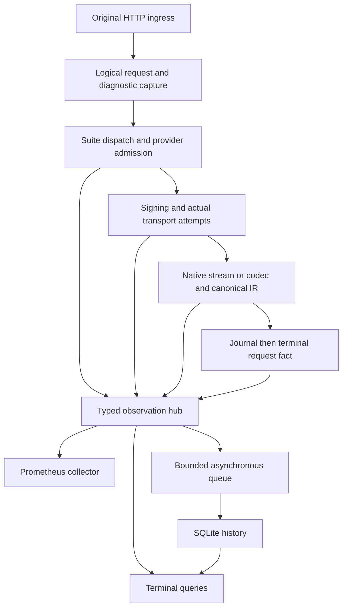

# Multi-provider observability and runtime console

**Implementation specification · 21 November 2026**

This document describes the implementation in this source tree. It supplements the existing [product identity](../PRODUCT.md), [gateway design](../DESIGN.md), and [runtime control contract](runtime-control-and-observation-contract.md). The terminal remains a Bubble Tea v2 application. Measurement collection runs in the gateway even when the terminal is disabled.

## 1. Operator experience

The console has eight numbered destinations: **1 Overview, 2 Requests, 3 Network, 4 Logs, 5 Concurrency, 6 Routes, 7 Insights, 8 Controls**. Existing provider identity, blue selection, green success, amber queue pressure, and red failure remain recognizable. More screen space reveals more detail; shrinking a pane changes its presentation without discarding the selected time range, provider, request, or investigation.

The principal investigation is one continuous path:

1. Notice an error, queue surge, latency tail, or conversion-loss increase.
2. Move the time cursor, brush a range, select a histogram bin, or compare providers.
3. Open the matching request cohort. Filter by outcome, stage, provider, live state, request ID, route/path, model, protocol, or fingerprint.
4. Open a request's exact retained Network entry. The join uses its process-epoch-qualified request ID. Eviction produces an explicit unavailable result; a nearby request is never substituted.
5. Inspect contracts, failure classification, approved losses, notes, SDK version metadata, actual attempts, and captured wire evidence.
6. Export the selected observations or a metadata investigation. A raw investigation requires typing `RAW` and reviewing its scope.
7. If appropriate, review a local runtime action: pause/resume/drain a provider, resize a configured pool, or cancel one live request.

The raw body buffer remains distinct from the durable measurement database. SQLite holds observations, bounded request facts, and markers. It does not silently turn on permanent prompt or response recording.

### Responsive composition

Layout derives from terminal cells, including wide and combining characters. The following sizes describe design behavior, not a list of exclusively supported resolutions.

| Space | Composition and interaction |
| --- | --- |
| 40×20 | One compact identity/status row; numbered rail with the active destination named; a full-width primary workspace; compact chart labels; request rows with essential outcome and timing; an in-place inspector with scrollable, wrapped sections. Controls and raw-export reviews paginate, keep Cancel visible, and require every page before Apply. |
| 40×40 | Same navigation and exact selection; the added height goes to heatmap rows, cohorts, evidence, and review text. Width does not become a prerequisite for useful investigation. |
| 60–71 columns | One-column inspection and charts with more readable labels and request context. No detached modal wider than the pane. |
| 72–109 columns | Existing richer header treatment and full workspace width; request tables add provider and attempt information when it fits. |
| 110+ columns | Insights can place a persistent numerical inspector beside the chart. Large surfaces show the chart, selected time cell, coverage, merged percentile bounds, and recorder health together. |
| Very short or extremely narrow | Text and navigation remain bounded. The active destination stays discoverable; content is scrollable. Mutating review buttons require at least 28 columns and six content rows so the action can be reviewed. 40×20 is a supported operating surface, not an emergency message. |

The tab rail collapses other destinations to their numeric targets while retaining the active name. At still smaller widths it uses previous/current/next targets. Painting and pointer hit testing use the same cell geometry. Resizing reflows the inspector and cancels an in-progress pointer gesture. A pending mouse press cannot activate a button after a resize or terminal blur.

The frame tests check 3,360 rendered frames across 210 size/theme combinations: widths 12–200, heights 6–48, both themes, every destination and every visualization. Tab pointer geometry is separately swept across widths 5–180. The PTY tests additionally exercise the real application, HTTP traffic, persistence, export, and control flows at small sizes. Bounds tests do not replace the PTY journeys.

### Keyboard and pointer model

| Area | Input | Result |
| --- | --- | --- |
| Global | `1`…`8`, click tab rail | Change destination |
| Global | `Tab` / `Shift+Tab` outside an inspector/review | Cycle provider |
| Global | `Ctrl+K`, `?` | Command palette and contextual help |
| Global | `q` / `Ctrl+C` outside text input | Exit and cancel outstanding UI queries |
| Lists | arrows or `j`/`k`, page keys, mouse wheel | Navigate without losing the selected logical request |
| Requests | `/`, `f`, `a`, `[` / `]` | Filter, failed-only shortcut, provider/all scope, result pages |
| Requests | `Enter`, `n`, `x` | Inspect fact, exact Network join, review live cancellation |
| Insights | `t` / `T`, `v` | Next/previous view; metric variant or pool |
| Insights | `w`, `r`, `f` | Preset window, explicit RFC3339 range, live follow |
| Insights | left/right or `h`/`l`, click plot | Time cursor in the displayed axis |
| Insights | `+` / `-`, `H` / `L` or page keys | Zoom around cursor; pan by half a window |
| Insights | `b`, move cursor, `Enter`; pointer drag | Brush an exact time range |
| Insights | up/down, Space | Select bin/series/provider; toggle selected line |
| Insights | `z`, `i`, `m`, `e` | Expand latency bin range, request cohort, event marker, measurement export |
| Inspector | `Tab` / `Shift+Tab`, arrows/page keys, `Esc` | Change evidence section, scroll, return |
| Exports | `e`, `E` | Metadata/measurement export; separately reviewed raw export |
| Reviews | page keys or arrows, Tab, Enter, Esc | Read each page, select Cancel/Apply, apply/cancel |

Text input has precedence over global shortcuts: typing `q`, digits, or provider/filter syntax edits the field. `Ctrl+U` clears input and Backspace removes a grapheme. The palette exposes available workflows and the help lists context-specific commands.

Review buttons require a matching press and release in the current layout. Scrolling, page changes, resize, or blur disarms the gesture. Cancel is initially selected. A 30-second runtime preview expires visibly and can be refreshed with `r`; refresh creates a new review against the current revision.

## 2. Interactive visualizations

All charts consume the same immutable observation query results. Their cursor, range selection, request-cohort link, and export share the accepted time axis. A slow query cannot relabel an old plot with a new range: results carry generations, superseded queries are cancelled, and stale responses are ignored. SQLite work does not run in `View()`.

| View | Measurements | Rendering and inspection |
| --- | --- | --- |
| Rates | Logical ingress, terminal outcomes, failed requests, actual upstream attempts | Colored Braille curves with two horizontal by four vertical subcells per terminal cell. Legend toggles, cursor values, brush, event strip, and interval drilldown. Missing coverage breaks the line. |
| Latency | Client duration, union of admission waits, actual-attempt duration | Time/duration density heatmap. Slow bins sit above fast bins. A logarithmic color/density ramp exposes tails without hiding smaller counts. Neighboring duration bins merge when height is scarce; selection reports the resulting interval bounds. `z` expands the full duration range. |
| Capacity | Occupied leases, cooldown leases, effective limit, queued waiters; fleet active/queued context | Time-integrated means, separate named pools, and exact known coverage. Default, route/group and global pools are not added as though they were disjoint capacity. Unlimited/unobserved global capacity stays unknown. |
| Distribution | Merged duration/admission/attempt histograms for the selected range | Interactive duration bars and percentile bounds. A selected bin opens the corresponding time-and-duration request cohort. Fleet percentiles come from merged bin counts. |
| Compare | Per-provider terminal counts, failures, attempts, duration distribution | Provider-selectable rows with proportional count bars and numerical context. Selecting a currently configured provider enters its detailed time view; retired historical identities remain inspectable in the selected cell. |
| Usage | Reported input/output/total tokens and usage-report coverage | Interactive rate/coverage views distinguish known zero from missing source data. No cost estimate or invented total is substituted for absent usage. |
| Fidelity | Approved conversion losses, conversion notes and request/response conversion failures | Over-time curves link loss or breakage periods to request facts and pinned-contract evidence. Omitted report entries are recorded separately; they are not guessed to be losses. |
| Attempts | Actual attempts, retry attempts, credential resends, upstream 429/status-family pressure | Over-time retry and upstream-status views expose amplification separately from logical client demand. Local rejection does not create an upstream attempt. |

The chart details expose raw counts, the elapsed denominator, coverage, histogram bounds, and partial/gap/overlap/clock-step state. The event strip includes local control changes and recorder discontinuity markers. A time cell with no observation can be selected and inspected as missing; the nearest observed sample is not silently substituted.

Request cohorts use the logical request's terminal time, or its start time while live. Client-duration and admission-wait histogram observations are published at logical finalization and therefore share their cohort boundary, even when the admission wait ended earlier. Actual-attempt observations can finish before the logical request: their drilldowns match the logical time range and selected duration bounds, and are labeled accordingly. They are not per-attempt-finish-time exemplar indexes. The full request-local attempt histogram preserves duration-bin matching after the 32 detailed-attempt limit; it does not reconstruct timestamps for omitted attempt details. Exact request-ID-to-journal joins remain exact.

### Rate, gauge and percentile rules

A complete rate is `observed_count / measured_elapsed_seconds`. The count is assigned to the sealed observation interval containing the event. A query never divides a request to manufacture fractional counts at a selection edge. Source intervals cut by the requested range are partial and excluded from the contained-interval count; the result exposes this uncertainty.

Gauge means are `sum(value × elapsed_nanoseconds) / known_elapsed_nanoseconds`, recorded on transitions, not inferred from TUI refresh samples. `occupied = caller-held leases + post-release cooldown leases`. A proxy failure hold still owns its lease; it is not the limiter's post-release cooldown. Adaptive withholding reduces effective capacity without creating fake occupancy. Shrink debt is the amount by which occupied leases exceed the new effective limit.

Histograms have 22 finite upper bounds, in seconds:

`0.001, 0.002, 0.005, 0.01, 0.02, 0.05, 0.1, 0.2, 0.5, 1, 2, 5, 10, 20, 30, 60, 120, 300, 600, 1800, 3600, 7200`, followed by an overflow bin.

The bins are disjoint internally and converted to cumulative buckets for Prometheus. Quantiles are displayed as bucket bounds, for example `p95 ≤ 2s`; they do not pretend to identify a more precise value inside that bin. Zero observations produce an unavailable quantile. The overflow bin has no finite upper bound.

## 3. Themes and terminal portability

The existing hue-to-state identity is retained. Dark and light themes use different ink values and selection treatment, rather than applying one palette to both backgrounds.

| Role | Dark | Light |
| --- | --- | --- |
| Primary text | `#E6EDF3` | `#24292F` |
| Information / chart blue | `#58A6FF` | `#0550AE` |
| Success | `#3FB950` | `#1A7F37` |
| Queue / warning orange | `#F0883E` | `#BC4C00` |
| Amber warning | `#D29922` | `#9A6700` |
| Failure | `#F85149` | `#CF222E` |
| Secondary ink | `#919AA5` | `#59636E` |
| Header | White on `#1F6FEB` | White on `#0969DA` |
| Selected row | Dark ink on `#388BFD` | White on `#0550AE` |

The automatic theme uses Bubble Tea's background-color negotiation. Explicit `-tui-theme dark` or `light` remains authoritative even if a late terminal background response arrives. `-tui-color` can request truecolor, 256 colors, 16 colors, or monochrome. Status words, selection arrows, density glyphs and numeric values remain meaningful when color is unavailable. A custom terminal's user-defined 16-color palette cannot be assigned a universal contrast guarantee; the explicit profiles and theme overrides remain available.

The runtime uses Bubble Tea v2's native input and terminal handling across supported platforms, including its Windows support. There is no browser embedded in the dashboard, no raster graphics protocol requirement, and no dependency on a particular terminal font for basic navigation. Unicode glyph presentation depends on the terminal's font fallback; cell measurement uses grapheme-aware width rules. Captured ANSI and text frames accompany the PNG/SVG gallery.

## 4. Measurement architecture

The canonical layer is `internal/observation`. `internal/history` is an optional sink and query source. The Prometheus collector and terminal read the same typed counters, histograms, request facts and transition integrals.



### Gateway integration points

| Boundary | Source integration | What is recorded |
| --- | --- | --- |
| Original ingress | `runtime_observability.go` around the final router | Stable request ID, original method/path, initial provider scope, client leg, cancellation/read interruption and fallback failures |
| Suite buffer admission | `internal/router/suiteadmission.go` | Actual blocked time, before provider resolution |
| Provider dispatch | `internal/proxy/observation.go`, `proxy.go` | Provider handoff without another logical arrival; bounded route metadata |
| Pause / route / global admission | `internal/control`, `internal/proxy`, `internal/queue` | Union of actual waits, FIFO leases, each pool transition |
| Base transport after signing | `internal/proxy/roundtrip.go`, `reauthtransport.go` | Actual attempt kind; response headers; body EOF/read/close outcome |
| Client decode / IR render | `internal/transcode/diagnostics.go`, handler files | Direction, contract manifest, capabilities, allowed losses, failure taxonomy and rendered request leg |
| JSON / SSE response conversion | `handlerresponse.go`, `handlerstream.go`, source stream states | Selected upstream leg, conversion reports, valid source usage presence, terminal classification |
| Downstream writer | `internal/diagnostic/writer.go` | Accepted byte counts, actual final HTTP status, short-write and flush failure, preserved controller/upgrade capabilities |
| Finalization | `internal/proxy/observation.go`, ingress fallback | Diagnostic snapshot and exact journal entry first, terminal fact second |
| Provider/control changes | `runtime_observability.go`, limiter observer | Transition integrals, reviewed change markers and bounded local audit |

Original-ingress received counts and terminal-provider counts are intentionally different cohorts. A suite request initially belongs to `__unresolved__`, then transfers its active scope after model dispatch. An unknown mount remains unresolved. Its received count is not retrospectively moved to make a table balance. Request facts retain both identities.

The observed layer does not clear when the legacy session display counters are reset. Prometheus scrapes do not seal an interval, consume events, run SQL, or wait for persistence. There is no self-scraping loop.

### Outcomes and actual attempts

A logical request is one client exchange. An upstream attempt is an actual signed `RoundTrip` invocation. Credential resends are counted separately from retry-policy attempts. A signer failure has no upstream attempt. Status headers and body completion are distinct: HTTP 200 can have a later upstream body failure or downstream write failure.

The selected native response remains opaque. Its bytes are counted at the body boundary without parsing an LLM schema or duplicating its body buffer. HTTP 101 ends the measured HTTP handshake and returns the bidirectional body unchanged; upgraded protocol traffic is outside these HTTP measurements.

A definitive upstream failure retains priority when cancellation or downstream error happens while conveying that failure. Earlier failed retries remain attempt facts even if the final logical result completes. The [control/observation contract](runtime-control-and-observation-contract.md) defines the detailed outcome table.

### Usage contract

Usage comes from source state already accepted by the real codec, after target bounds and successful delivery at the final semantic boundary. It is not scraped from arbitrary body bytes or inferred for native requests. The instrumentation covers all eight supported transcoding directions in JSON and SSE paths.

Each component carries a presence bit. Reported zero is known. A target-required synthesized zero is unknown. A source-absent total derived to satisfy a target dialect is not a reported total. Anthropic Messages has no reported total; input plus output is not silently published as one. A truncated, malformed, output-bound or unsuccessfully delivered response does not publish final usage. Consequently these counters describe covered, successfully delivered source reports; they are not a provider billing ledger.

The first valid report contributes the monotonic token counters. A subsequent changed value/presence is a separately counted correction and updates the request fact; it does not add the entire revised cumulative total again. A source-name spelling change alone is not a correction. Overflow is counted explicitly instead of wrapping a token counter.

## 5. Prometheus contract

The existing `shaper_*` families remain available. New families use the `shaper_observed_` prefix. Provider names are configured and bounded; side, class and stage are fixed enumerations. Request IDs, models, paths, URLs, fingerprints, raw error text and arbitrary resource labels are not Prometheus dimensions.

An unnamed single-provider invocation keeps the legacy `provider="default"` label. The canonical collector uses the provider's effective identity, derived from its upstream host when no name is supplied. That compatibility mapping is explicit; a join across old and new metric families must account for it. Legacy statistics reset retains its original scope and does not reset the canonical process-lifetime counters or stored history.

| Family suffix | Type / additional labels | Semantics |
| --- | --- | --- |
| `requests_received_total` | Counter | Original ingress cohort |
| `requests_terminal_total` | Counter | Once-only classified terminal request |
| `classified_completed_total` | Counter | Completed logical exchanges; status alone is insufficient |
| `requests_failed_total`, `requests_aborted_total`, `requests_rejected_total`, `requests_unknown_total` | Counters | Explicit logical outcome categories |
| `requests_cancelled_total` | Counter | Observed cancellation flag; may coexist with a definitive failure |
| `upstream_attempts_total`, `upstream_retries_total`, `auth_resends_total` | Counters | Actual transport attempts, retry-policy attempts and credential resends |
| `upstream_429_total`, `upstream_401_total`, `upstream_5xx_total` | Counters | Actual upstream response headers |
| `conversion_losses_total`, `conversion_notes_total`, `conversion_dropped_total` | Counters | Approved retained loss decisions, retained notes, unclassified report omissions |
| `usage_reports_total`, `usage_input_known_total`, `usage_output_known_total`, `usage_total_known_total` | Counters | First report and per-component coverage, including known zero |
| `usage_input_tokens_total`, `usage_output_tokens_total`, `usage_total_tokens_total` | Counters | First valid covered reports, without inferred totals |
| `usage_corrections_total`, `usage_overflow_total` | Counters | Later changed reports and omitted overflowing additions |
| `active_requests`, `queued_requests`, `upstream_exchanges` | Gauges | Current logical active/union-wait and open actual-attempt state |
| `http_status_total` | Counter; `side`, `class` | Downstream/upstream and 1xx…5xx; status zero creates no response class |
| `failures_by_stage_total` | Counter; `stage` | Failed/rejected logical requests by fixed provenance stage |
| `client_duration_seconds` | Histogram | Original ingress through classified terminal result, including queue |
| `admission_wait_seconds` | Histogram | Union of actual admission waits, one sample per request that waited |
| `attempt_duration_seconds` | Histogram | Actual attempt through body end; 101 through handshake |
| `history_enabled`, `history_writer_healthy` | Gauges, no provider label | Optional recorder status |
| `history_pending_packets`, `history_queue_capacity` | Gauges | Queue depth and packet limit |
| `history_buffered_bytes`, `history_buffer_byte_capacity` | Gauges | Conservative queue/in-flight payload budget and its limit |
| `history_committed_through_timestamp_seconds` | Gauge | Most recent committed observation boundary; absent until a commit exists |
| `history_dropped_batches_total`, `history_dropped_facts_total`, `history_dropped_markers_total`, `history_write_errors_total` | Counters | Explicit persistence omissions and failed transactions |

The collector implements the official `prometheus.Collector` interface. The endpoint uses an explicit registry and the official exposition formatter beside the established legacy formatter. Its tests parse the combined endpoint with the official parser and verify repeated scrapes do not change counts.

## 6. SQLite design and operational limits

History is opt-in through `-history-db PATH`. An empty path uses bounded live memory and creates no database. The driver is `modernc.org/sqlite`, pinned with its compatible `modernc.org/libc` version. It is Go-native and the gateway builds with `CGO_ENABLED=0`.

| Concern | Implemented contract |
| --- | --- |
| Ownership | Ordinary local filesystem path, application ID `0x41495348`, schema version 1. Unrelated or unsupported databases fail closed. URI and network-share paths are rejected. |
| Connections | One mutation connection; at most two query connections. WAL mode. |
| Asynchronous path | At most 64 queued packets, with a conservative 64 MiB queued-plus-in-flight payload budget. Request completion does no SQLite I/O. |
| Default detail retention | Raw one-second observations for about 15 minutes, minute rollups for about 24 hours, hourly rollups for seven days. Boundaries round outward to preserve whole intervals. |
| Configurable horizon | `-history-retention` from 1 hour to 8760 hours controls the final horizon. Fine-resolution windows have their own retention bounds. |
| Facts | At most 10,000 retained request facts, also subject to time retention; at most 32 detailed attempts per fact, plus full attempt count and histogram. |
| Memory facts | At most 10,000 tracked live IDs and 10,000 recent completed facts. Excess live tracking is reported explicitly; it does not prevent request proxying. |
| Memory intervals | Up to 15 minutes and at most 12,000 intervals shared across provider scopes. Large fleets reach the count limit earlier; unavailable coverage remains explicit. |
| Scope | At most 128 configured providers, plus unresolved scope; provider identities at most 256 UTF-8 bytes; at most 256 admission resources per provider. |
| Query | Increasing nonzero time range up to 366 days; at most 1,000 output points and 100,000 source rows; at most 64 MiB encoded source data; two-second cooperative cancellation budget across the hub query. Cancellation joins bounded decode work, so this is not a guaranteed wall-clock return bound. |
| Historical scope | At most 129 distinct historical provider identities and 256 distinct resources per provider in an accepted query. A broader selection returns an explicit narrow-scope error, including across renamed/restarted fleets. |
| Decode | Four workers, four queued decode jobs; workers join on cancellation and error. |
| Write | Bounded batches, ten-second transaction context, explicit health/error state and orderly drain on shutdown. |
| Durability | WAL `NORMAL` default or `FULL` through a CLI flag. Both still have an asynchronous in-memory queue. |

The SQL schema separates `buckets`, `rollups`, `receipts`, `requests`, `markers`, and `metadata`. Raw/rollup payloads are version-owned typed JSON with query/index columns outside the payload. Time-range and request ordering indexes bound selection work. The schema is application-owned; it is not a generic PromQL store.

Rollups are absolute per epoch/provider/window. A receipt binds `(epoch, sequence, provider)` to its SHA-256 payload digest. An identical replay is idempotent; a conflicting replay rolls the transaction back. Higher and lower tiers are alternative representations of the same observations. The query selects a parent or its children, and overlays the live in-memory tail without counting both.

Retention watermarks do not move backwards when the wall clock does. A later interval falling into an older window updates its existing absolute rollup instead of rebuilding that window from the surviving raw tail. Tests cover this case explicitly.

### Time and coverage

Go's monotonic clock information is process-local and does not survive JSON serialization. Every interval therefore stores its measured elapsed duration separately from its wall-clock endpoints. The recorder samples a clock-reading bracket and carries uncertainty rather than assuming serialized wall duration equals elapsed duration. Clock steps, gaps, overlapping epochs, and partial source coverage remain visible.

Counts from distinct epochs can be retained even when their wall time overlaps. That overlap does not justify a complete gauge denominator or a smooth rate. Incomplete cells have no trusted rate denominator. Zero traffic during a completely observed interval remains a real zero.

A full recorder queue drops telemetry, not requests. Counters and the live ring continue. Health exposes omitted batches/facts/markers and transaction failures; a later successful commit writes a discontinuity marker. An abrupt process crash can lose the queued tail and its not-yet-persisted drop information. `FULL` improves committed transaction durability, not in-memory queue durability. A committed-through watermark is not an assertion that no earlier observations were dropped.

## 7. Transcoding evidence and failure investigation

The original client body is observed before provider mounts, suite dispatch or model remapping. The four diagnostic legs are original client request, rendered upstream request before signing, selected upstream response, and bytes accepted downstream. Native passthrough remains opaque and uses the established journal wire buffers for body inspection.

`-diagnostic-capture-bytes` controls a **total per-request** budget from zero to 1 MiB, split fairly between the four legs so a large input cannot consume all response evidence. Zero retains metadata and byte/completion state. Each leg distinguishes whether it was observed, whether its byte count is known, retained bytes, total observed bytes, truncation, EOF/completion, content type and HTTP status. Not reading a rejected request body is not evidence of an empty body.

A diagnostic snapshot includes up to 32 stages, 128 decisions, eight failures, pinned contract versions/checksums and manifest digest, direction, stream mode, resolved/client model, selected capabilities and allowed losses. It retains only named protocol/SDK version headers in the version metadata. The regular Network journal still has local raw headers by its established contract.

Failure fingerprints hash the controlled stage/kind/feature/direction taxonomy. They exclude user paths, model strings and free error detail. The fingerprint groups a useful class of failures; it is not a unique signature of every distinct unsupported field. Local evidence preserves the specific path and detail. A standard JSON decoder's leaf-only unknown-field report is labeled as such (`$..field`) rather than inventing an exact nested path.

### Anthropic behavior verified during implementation

An unknown client request field is rejected locally under the existing strict contract. The new tests confirm no transport invocation, a real 400, the exact logical request, request-decode evidence, the unknown-field failure kind, and a retained client prefix when capture is enabled. This is the workflow for investigating a routine client/SDK update that introduces a field outside the pinned conversion contract: the original request, the precise decode failure and the active contract version remain joined for investigation.

The conversion matrix exposed a real streaming bug: an Anthropic thinking block can begin before its signature arrives in a later `signature_delta`. The implementation now decodes that stream-start shape separately. It does not synthesize a signature. A complete/replayed thinking block still requires its signature, and malformed/null/conflicting stream fields remain rejected. Cross-provider handling of authenticated thinking remains governed by the explicit loss policy.

The official Anthropic documentation describes both this streaming sequence and additive API evolution. Strict client contracts can therefore reveal compatibility gaps even when an upstream maintains its version header; the correct response is to retain precise evidence and deliberately update the codec, not silently discard the new client option.

The existing opt-in full-flow recorder gains `request_id` alongside its local flow ID, so an external flow file can be joined with a request fact and journal entry. Its existing raw-data semantics remain explicit.

## 8. Exports

Exports operate on a frozen selection and write a fresh local file in `-export-dir`. They use an exclusive random filename, mode 0600 where supported, a checked write and file sync. They never overwrite a prior export. A failed write removes only the partial file created by that operation. Windows access is governed by the containing directory's ACL; a POSIX mode is not a substitute for an ACL.

| Export | Contents / boundary |
| --- | --- |
| Measurements | Accepted query and selected whole time cells, provider series, markers, coverage and explicit edge policy |
| Request facts | The accepted query associated with the displayed page, its bounded results and pagination metadata |
| Logs | Selected/filtered retained lines with their filter scope |
| Controls | Current local control state and bounded audit |
| Metadata investigation | Request/journal ID, timing, outcome, controlled failure metadata, contract hashes, counts and truncation; bodies and private free-form HTTP/model/path/error values omitted |
| Raw investigation | Selected retained wire/evidence bytes and headers, after typed `RAW` consent and fully paged review |

Investigation bundles use `shaper.investigation/v1`. `bodies_omitted` is explicit. Missing requested IDs are listed. The SHA-256 covers the exact compact serialized `entries` byte array, identified by `digest_scope=entries_json_bytes`; it is an integrity aid, not a signature over the outer envelope. Export does not claim that a truncated body is complete.

History and request-fact exports retain bounded operational metadata such as paths, routes and models, including when diagnostic body capture is zero. Generic request and log exports preserve their displayed data and filter scope. The metadata-investigation redaction policy applies specifically to investigation bundles; it is not a blanket redaction policy for every export. Typed `RAW` review gates the investigation's retained wire bodies and arbitrary HTTP headers/URLs.

Each file is bounded to 64 MiB. Raw selections receive a size preflight before body copies, and metadata mode copies evidence without copying its body prefixes. Oversized selections fail with an instruction to narrow the selection. UI evidence viewing caps a displayed body prefix at 256 KiB while raw export can include all retained bytes within the export limit.

## 9. Runtime controls

The local controller exposes pause, resume, drain, positive pool resize and exact request cancellation. It has no network control endpoint. Previewing has no effect; applying a token checks its frozen command, revision, expiry and, for resize, the limiter's own configured-limit revision.

Pause holds new admissions at the provider gate before that gate reads a body or enters breaker admission. A suite router may already have performed its bounded model-dispatch body read to resolve the provider. Work already given permission, including limiter waiters, continues. Drain rejects new admissions with local 503 while local model discovery remains available. Resize preserves existing leases and cooldowns and uses FIFO grants. A smaller limit creates debt until releases bring occupancy below capacity. A larger limit may immediately admit waiters. No operation clears the circuit breaker or bypasses its policy.

An optional TTL up to 24 hours restores the process's current non-expiring baseline unless a newer operation supersedes it. Independent programmatic limiter changes also invalidate a pending preview or stale expiry. Applied actions and expiries appear in the audit and history marker stream. A newer applied action silently replaces the preceding TTL timer; the newer action itself is the audit record. An independent limiter change detected at expiry produces a separate superseded record. A restart reloads CLI settings.

Exact cancellation is cooperative. It interrupts pre-provider buffered-body reads, provider waits and transport context, while retaining known failure/cancel holds. It does not claim the remote model stopped. If it ends an exchange before headers, the client connection is aborted rather than returning an accidental empty 200. Normal finalization cancellation is separately recognized and does not disturb keepalive reuse.

See [runtime-control-and-observation-contract.md](runtime-control-and-observation-contract.md) for the full action table, lease invariant and precedence rules.

## 10. Dependency choice and research

| Option | Assessment and implementation decision |
| --- | --- |
| Official `prometheus/client_golang` collector + shared typed hub | Selected. Provides supported descriptors, histograms, collection and exposition without making the terminal scrape itself. The existing legacy endpoint remains available. |
| Embed `prometheus/prometheus` storage/query internals | Considered and declined. The project explicitly distinguishes its reusable client/common libraries from the server repository, whose internal Go APIs are not maintained as stable library APIs. A full server/PromQL engine also does not supply the required exact request/control/evidence model. |
| Scrape the existing endpoint into SQLite | Considered and declined. It loses request identity and exact transitions, introduces reset/interval reconstruction, and duplicates collection. The shared hub is the integration point instead. |
| `modernc.org/sqlite` | Selected. Go-native driver, ordinary `database/sql`, explicit compatible libc pin and supported target matrix. WAL, transactions and local ownership provide the needed optional history layer. |
| `ncruces/go-sqlite3` | A credible alternative with a different SQLite compilation/runtime integration. The selected driver already meets this project's Go-only and cross-build constraints; changing drivers would not remove the need for the same queue, coverage and replay semantics. |
| Native C SQLite driver | Does not meet the requested Go-native constraint. |
| Full external observability backend | The Prometheus endpoint remains the external integration. This local dashboard can run without deploying a separate server. Remote querying or remote write is not added by this patch. |

Primary research references:

- [Charm v2 release and input/rendering model](https://charm.land/blog/v2/)
- [Bubble Tea v2](https://github.com/charmbracelet/bubbletea)
- [Prometheus client library support and stability](https://github.com/prometheus/client_golang)
- [Prometheus server: using its repository as a Go library](https://github.com/prometheus/prometheus#using-prometheus-as-a-go-library)
- [modernc SQLite documentation and libc dependency guidance](https://pkg.go.dev/modernc.org/sqlite)
- [Alternative Go SQLite implementation](https://github.com/ncruces/go-sqlite3)
- [SQLite WAL behavior](https://sqlite.org/wal.html)
- [SQLite synchronous durability modes](https://sqlite.org/pragma.html#pragma_synchronous)
- [Go monotonic clocks and serialization](https://pkg.go.dev/time#hdr-Monotonic_Clocks)
- [Anthropic streaming events, thinking and signatures](https://platform.claude.com/docs/en/build-with-claude/streaming)
- [Anthropic API versioning](https://platform.claude.com/docs/en/api/versioning)
- [Freeze terminal-output rendering](https://github.com/charmbracelet/freeze)

Dependency longevity is a choice supported by maintainership, documented compatibility and pinned modules, not a guarantee of future maintenance. The exact versions are in `go.mod` and `go.sum`.

## 11. Build, run, and verify

This source tree uses the upstream Go version declared in `go.mod` (Go 1.27.2). A headless invocation still collects observations and can expose metrics/history.

```sh
go build -o shaper .
./shaper -bind 127.0.0.1:8080 -tui \
  -history-db ./observations.sqlite \
  -history-retention 168h -history-durability normal \
  -diagnostic-capture-bytes 65536 -export-dir . \
  -tui-theme auto -tui-color auto \
  -metrics-bind 127.0.0.1:9090 \
  --provider=alpha -prefix /alpha -upstream https://alpha.example \
  --provider=beta -prefix /beta -upstream https://beta.example
```

All new flags are server-scoped and precede the first `--provider` marker. Existing provider-scoped authentication, route, retry, cooldown, breaker and transcode flags retain their existing placement. The example upstreams are placeholders. The diagnostic capture is optional and distinct from the existing journal body retention.

```sh
go test -count=1 -timeout=20m ./...
GOFLAGS=-race go test -race -p=1 -count=1 -timeout=20m ./...
make lint
CGO_ENABLED=0 go build ./...
```

The race command serializes packages so unrelated CPU-heavy scale fixtures do not compete against the public query deadline. It retains every assertion; `GOFLAGS=-race` also instruments gateway subprocesses built by integration tests. This same execution policy is configured in Linux CI. Internal concurrent operations and tests still run with the race detector.

The delivered verification report records actual commands, source hashes, test outcomes, skips, render reproduction and cross-build targets. Native macOS/Windows execution is configured in CI; Linux cross-compilation is reported separately from executing on those operating systems. No result is inferred from a successful screenshot or a successful compile.

The gallery is generated by the production `Model.View` using deterministic, explicitly synthetic observations. Its source generator lives in `internal/tui/observability_render_test.go`. Real PTY journeys additionally exercise the running gateway. Render fixtures do not imply production traffic or replace behavior tests.
